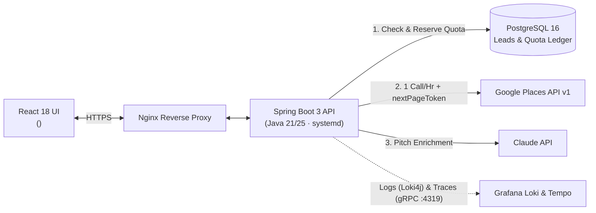

# Building Hitlist: 5 Production Bugs, Design Trade-Offs, and How I Solved Them

Hi, I'm **Thabo Ndashe**. I built **Hitlist**—a full-stack Java/Spring Boot and React platform that discovers local businesses without websites (like plumbers, dental clinics, and contractors) so digital agencies can pitch them.

Any tutorial app works on happy-path data. The real engineering starts when third-party APIs change their billing rules, JDK upgrades break your test runner, and a "successful" cron job silently returns zero rows.

I put this repo together to walk you through **five real problems I hit in production**, why my first idea didn't work, how I tracked down the root cause, and what I traded off in the fix.

**Tech Stack:** `Java 21/25` · `Spring Boot 3` · `PostgreSQL 16` · `Redis` · `React 18` · `TanStack Table v8` · `OpenTelemetry & Grafana (Loki/Tempo)` · `Linux systemd`

---

## 1. Five Problems I Solved (10-Second Scan)

| # | Story | The Problem | How I Solved It | Result |
| :-: | :--- | :--- | :--- | :--- |
| **01** | **[Keeping Google API Costs at $0](case-studies/01-keeping-google-api-costs-at-zero.md)** | Google capped free Places calls at 1,000/mo, and my first budget-pause check accidentally caused a 15-min infinite retry loop. | Postgres micro-dollar ledger, 1-call/hr cap, `nextPageToken` deep pagination, modulo city rotation, and soft budget caps. | **$0/mo API spend** (720 calls/mo) & 0 infinite loops. |
| **02** | **[Dropping Mockito for Java 25](case-studies/02-dropping-mockito-for-java-25.md)** | Upgrading to OpenJDK 25 crashed every unit test (`Byte Buddy` classfile v69 error + `sun.misc.Unsafe` warnings). | Dropped Mockito for a 70-line `ConcurrentHashMap` `JpaRepository` fake + Testcontainers PostgreSQL 16. | **<50ms unit tests**, 0 JVM warnings, Java 25+ ready. |
| **03** | **[Debugging a Silent 0-Lead Bug](case-studies/03-debugging-a-silent-api-failure.md)** | After migrating to Google's `POST /v1/places:searchText` API, runs finished in 200ms saying `0 leads, 0 errors`. | Fixed 3 stacked bugs: `UriComponentsBuilder` turning `:searchText` into `/:searchText` (404), a swallowed catch block, and strict Jackson DTO parsing. | **Restored 0-website lead discovery** with 0 changes to core pipeline code. |
| **04** | **[Fixing React Table Flicker](case-studies/04-fixing-react-table-flicker.md)** | Filtering or changing pages on Leads and Outreach caused a harsh strobe effect and made the footer jump up and down. | Found `<50ms` local API responses were flipping table opacity `1.0 -> 0.5 -> 1.0`. Built a shared `<DataTable />` with a 2px top pulse bar and locked min-height. | **Zero visual flicker**, zero layout shift, and reusable table code. |
| **05** | **[Bare-Metal Deploys & Tracing](case-studies/05-bare-metal-logging-and-deploys.md)** | OpenTelemetry traces failed (`Connection reset by peer`), Loki rejected logs (`HTTP 400`), and SCP wildcards dropped build files. | Pinned OTel to `grpc` on port `4319`, disabled Loki v11 structured metadata in Logback, switched deploys to atomic `rsync`, and sandboxed `systemd`. | **End-to-end logs + traces** and reliable bare-metal CI/CD rollouts. |

---

## 2. How the System Fits Together



---

## 3. Run the Code Proofs Locally (Takes 3 Seconds)

You don't need Docker, PostgreSQL, or API keys to run the code in this repo. The [`code-proofs/`](code-proofs/) folder is a standalone Maven project with JUnit 5 tests for the **Quota Guardrail Ledger**, **Campaign Permutation Engine**, and **Zero-Bytecode In-Memory Repository Fakes**.

```bash
cd code-proofs
mvn clean test
```

---

## 4. Live Codebase Stats (Auto-Synced)

Whenever I commit to my main `hitlist` repo, a Git hook automatically sanitizes and updates these stats.

<!-- AUTO-SYNC:METRICS:START -->
| Metric | Count | Details |
| :--- | :--- | :--- |
| **Last Synced** | `2026-11-10` (`hitlist@3a2129f`) | Auto-synced via Git hook from main `hitlist` repo |
| **Backend Java Classes** | `118` | Spring Boot 3 (`auth`, `leads`, `outreach`, `fulfillment`, `integrations`) |
| **Zero-Bytecode Test & Fake Classes** | `33` | Pure-Java in-memory `JpaRepository` fakes + Testcontainers PostgreSQL 16 |
| **Frontend React Components** | `28` | React 18 + TanStack Table v8 |
<!-- AUTO-SYNC:METRICS:END -->


