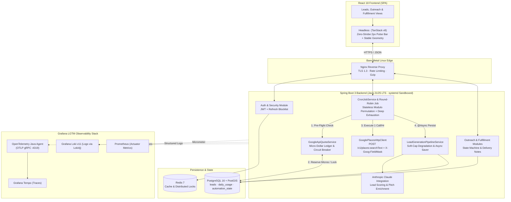

# Hitlist Engineering Architecture & Problem-Solving Showcase

> **Full-Stack & Systems Engineer** | `Java 21/25 LTS` · `Spring Boot 3` · `PostgreSQL 16 + PostGIS` · `Redis` · `React 18` · `TanStack Table v8` · `OpenTelemetry` · `Grafana LGTM` · `Linux systemd`

Welcome to the architectural showcase and engineering problem-solving repository for **SME Hitlist**—an automated B2B lead discovery, multi-campaign geographic permutation, outreach intelligence, and fulfillment platform.

This repository is structured for two distinct readers:
1. **Talent Recruiters (60-Second Executive Scan):** Start with the **[Live System Telemetry](#1-live-engineering-telemetry-auto-synced)**, **[Quantified Impact Matrix](#2-problem-solving--impact-matrix-hiring-manager-navigator)**, and the 1-page **[Executive Brief](docs/EXECUTIVE_BRIEF.md)**.
2. **Engineering Hiring Managers & Staff Engineers (5–15 Minute Technical Deep-Dive):** Explore the **[5 Production Case Studies](#2-problem-solving--impact-matrix-hiring-manager-navigator)** (*Context $\rightarrow$ Why Naive Approaches Failed $\rightarrow$ Root-Cause Diagnosis $\rightarrow$ Architectural Solution $\rightarrow$ Trade-offs*), review **[Kruchten's 4+1 Architecture](docs/SYSTEM_ARCHITECTURE.md)** and **[Full ADR Catalog](docs/adr/FULL_ADR_CATALOG.md)**, or execute the **[Zero-Setup Runnable Code Proofs (`mvn test`)](#4-runnable-code-proofs-zero-setup-maven-verification)** in under 3 seconds.

---

## 1. Live Engineering Telemetry (Auto-Synced)

<!-- AUTO-SYNC:METRICS:START -->
| Metric / Artifact | Live Value | Source Verification |
| :--- | :--- | :--- |
| **Last Synced Main-Repo Commit** | `3a2129f` (`test` · `2026-09-01 04:09:39 +0300`) | Auto-synced via `.githooks/post-commit` & `sync-showcase-repo.ps1` |
| **Production ADRs & Post-Mortems** | `8` | Consolidated in [`docs/adr/FULL_ADR_CATALOG.md`](docs/adr/FULL_ADR_CATALOG.md) |
| **Backend Production Java Classes** | `118` | Modular Spring Boot 3 domain packages (`auth`, `leads`, `outreach`, `fulfillment`, `integrations`) |
| **Zero-Bytecode Test & Fake Classes** | `33` | Pure Java `ConcurrentHashMap` JPA Fakes + Testcontainers PostgreSQL 16 |
| **Frontend React Components & Views** | `28` | React 18 + Headless TanStack Table v8 |
| **Core SRS Functional Modules** | `7` | Mirrored in [`docs/SYSTEM_DESIGN_BASELINE.md`](docs/SYSTEM_DESIGN_BASELINE.md) |
<!-- AUTO-SYNC:METRICS:END -->

---

## 2. Problem-Solving & Impact Matrix (Hiring Manager Navigator)

Every case study below documents a real production bottleneck or failure encountered while building and operating Hitlist, how naive fixes failed, the root-cause forensic investigation, and the resulting architectural design.

| # | Engineering Pillar & Case Study | Core Problem Solved | Architectural Solution | Quantified Outcome |
| :-: | :--- | :--- | :--- | :--- |
| **01** | **[FinOps API Cost Guardrails & Permutation Engine](docs/case-studies/01-finops-api-cost-guardrails-and-permutation.md)** | Google Places Enterprise SKU capped free usage at **1,000 events/month**, while per-run hard budget pauses (`paused=true`) triggered an infinite 15-minute auto-resume loop that wasted quota and produced 0 leads. | Engineered a pre-flight micro-dollar (`$10^{-6}`) ledger (`GoogleApiQuotaService`) with `OVER_QUERY_LIMIT` billing circuit-breakers, `02:00 Europe/Istanbul` auto-resume, **Deep Pagination Exhaustion** (`nextPageToken`), **Stateless Modulo Permutations** (`iteration % N`), and **Soft-Cap Graceful Degradation**. | **100% Free-Tier Compliance** (720/1,000 monthly calls), **0 infinite loops**, and deterministic rotation across arbitrary Country $\times$ City $\times$ Category matrices. |
| **02** | **[Zero-Bytecode Java 25 LTS Testing Architecture](docs/case-studies/02-zero-bytecode-java25-testing-architecture.md)** | Upgrading to OpenJDK 25 LTS (classfile v69) broke unit tests with `IllegalArgumentException: Java 25 (69) is not supported by Byte Buddy` and emitted terminal `sun.misc.Unsafe` dynamic agent warnings from Mockito. | Eradicated `mockito-core` and `byte-buddy` completely. Architected a generic, thread-safe `InMemoryJpaRepository<T, ID>` and `InMemorySpecificationExecutorRepository<T, ID>` fake hierarchy for unit tests, paired with **Testcontainers PostgreSQL 16** (`@ServiceConnection`) for integration tests. | **Sub-50ms** in-memory unit test execution, **0 bytecode/Unsafe warnings** on JDK 21–25+, and 100% real PostgreSQL dialect fidelity. |
| **03** | **[Post-Mortem: Google Places v1 Silent Failure](docs/case-studies/03-google-places-v1-silent-failure-postmortem.md)** | Legacy Places API biased results toward businesses *with* websites, starving the 0-website SME pipeline. After migrating to `POST /v1/places:searchText`, runs silently completed with `0 candidates, 0 errors`. | Conducted a 3-layer forensic investigation: (1) Fixed `UriComponentsBuilder` mutating `:searchText` into `/:searchText` (HTTP 404), (2) eliminated swallowed exception blocks, (3) enforced `@JsonIgnoreProperties(ignoreUnknown = true)` & `X-Goog-FieldMask` headers behind an **Anti-Corruption DTO Mapper**. | Restored **0-website SME discovery**, isolated API migration blast radius to `integrations/google` (**0 changes** to core pipeline service), and eliminated schema-drift crashes. |
| **04** | **[Frontend UX: Eliminating Table Strobing & Layout Shift](docs/case-studies/04-frontend-ux-table-strobing-and-stability.md)** | Filtering or paginating on Leads and Outreach pages caused jarring visual "strobing" and violent page height collapse, even after migrating to TanStack Table v8. | Diagnosed sub-50ms local API responses flipping `opacity: 1.0 -> 0.5 -> 1.0`. Engineered a reusable headless `<DataTable />` wrapper with a 2px top indeterminate pulse bar, `1.0` row opacity with `pointerEvents` gating, and `minHeight: 400px` geometry stabilization. | **Zero visual flicker**, **zero cumulative layout shift (CLS)** across empty/filtered states, and unified table markup across all domain modules. |
| **05** | **[Bare-Metal LGTM Observability & CI/CD Hardening](docs/case-studies/05-bare-metal-lgtm-observability-and-cicd.md)** | Production telemetry suffered `Connection reset by peer` on Grafana Tempo and `HTTP 400` rejections on Loki v11, while GitHub Actions SCP wildcards silently dropped build artifacts. | Mapped Tempo OTLP gRPC to port `4319` with `OTEL_EXPORTER_OTLP_PROTOCOL=grpc`, disabled Loki v11 structured metadata at the `<appender>` root, replaced SCP wildcards with atomic temp staging + `rsync`, and hardened `systemd` (`NoNewPrivileges`, `ProtectSystem=full`). | Full distributed tracing & log correlation across Nginx $\rightarrow$ Spring Boot $\rightarrow$ PostgreSQL, deterministic CI/CD rollouts, and sandboxed Linux runtime privileges. |

---

## 3. End-to-End System Topology



---

## 4. Runnable Code Proofs (Zero-Setup Maven Verification)

Hiring managers and technical interviewers do not need Docker, PostgreSQL, or API keys to verify the core engineering patterns in this repository. The [`code-proofs/`](code-proofs/) directory contains a standalone, zero-dependency **Java 21+ Maven module** demonstrating:

1. **Pre-Flight Micro-Dollar Quota Guardrails & Billing Lockdown Circuit Breaker** ([`ApiQuotaGuardrailService.java`](code-proofs/src/main/java/com/portfolio/hitlist/quota/ApiQuotaGuardrailService.java))
2. **Deep Pagination Exhaustion + Stateless Modulo Permutation Engine** ([`CampaignPermutationEngine.java`](code-proofs/src/main/java/com/portfolio/hitlist/permutation/CampaignPermutationEngine.java))
3. **Zero-Bytecode Generic In-Memory Repository Fake Framework** ([`InMemoryRepository.java`](code-proofs/src/test/java/com/portfolio/hitlist/fakes/InMemoryRepository.java))

### Run the Verification Suite Locally (< 3 Seconds)

```bash
cd code-proofs
mvn clean test
```

---

## 5. Repository Navigation & Auto-Synced Documentation Catalog

### Curated Executive & Architecture Docs
* **[`docs/EXECUTIVE_BRIEF.md`](docs/EXECUTIVE_BRIEF.md)** — 1-Page Recruiter & Hiring Manager Pitch Sheet (Core Competencies, Quantified Impact, Role Fit).
* **[`docs/SYSTEM_ARCHITECTURE.md`](docs/SYSTEM_ARCHITECTURE.md)** — Kruchten's 4+1 View Model (Logical CBSE Contracts, Process Concurrency, Development Structure, Physical Bare-Metal Topology, +1 Scenarios).
* **[`docs/adr/FULL_ADR_CATALOG.md`](docs/adr/FULL_ADR_CATALOG.md)** — Complete, searchable compendium of all Architecture Decision Records and Post-Mortems automatically synchronized from the main `hitlist` repository.
* **[`docs/SYSTEM_DESIGN_BASELINE.md`](docs/SYSTEM_DESIGN_BASELINE.md)** — Auto-synced and sanitized Software Requirements & Domain Architecture baseline.
* **[`docs/OPERATIONS_AND_TROUBLESHOOTING.md`](docs/OPERATIONS_AND_TROUBLESHOOTING.md)** — Auto-synced production guardrails, LGTM observability runbook, and CI/CD troubleshooting guide.

### Auto-Synced ADR & Post-Mortem Index
<!-- AUTO-SYNC:ADR-INDEX:START -->
| ADR ID | Decision / Post-Mortem Title | Type | Artifact Link |
| :--- | :--- | :--- | :--- |
| **ADR-001** | ADR 001: Data Table Flickering and Standardization | Architecture Decision Record | [`docs/adr/ADR-001-DataTable-Flickering-Resolution.md`](docs/adr/ADR-001-DataTable-Flickering-Resolution.md) |
| **ADR-002** | ADR 002: Search Campaign Permutations & Free-Tier Deep Exhaustion | Architecture Decision Record | [`docs/adr/ADR-002-Search-Campaign-Permutations.md`](docs/adr/ADR-002-Search-Campaign-Permutations.md) |
| **ADR-003** | ADR 003: Zero-Bytecode Test Architecture & Testcontainers Integration | Architecture Decision Record | [`docs/adr/ADR-003-Zero-Bytecode-Architecture-and-Testcontainers.md`](docs/adr/ADR-003-Zero-Bytecode-Architecture-and-Testcontainers.md) |
| **ADR-004** | ADR 004: Automated Architecture Showcase & 4-Layer Cross-Repository Synchronization | Architecture Decision Record | [`docs/adr/ADR-004-Automated-Showcase-Portfolio-Synchronization.md`](docs/adr/ADR-004-Automated-Showcase-Portfolio-Synchronization.md) |
| **ADR-005** | Implementation Document: Dynamic Lead Generation Configuration & Architecture | Implementation & Post-Mortem Record | [`docs/adr/ADR-005-dynamic-config-architecture.md`](docs/adr/ADR-005-dynamic-config-architecture.md) |
| **ADR-006** | Implementation Document: Upgrade to New Google Places API | Implementation & Post-Mortem Record | [`docs/adr/ADR-006-google-places-new-api-upgrade.md`](docs/adr/ADR-006-google-places-new-api-upgrade.md) |
| **ADR-007** | Post-Mortem: Google Places API Silent Failure & DTO Mapping | Implementation & Post-Mortem Record | [`docs/adr/ADR-007-google-places-silent-failure.md`](docs/adr/ADR-007-google-places-silent-failure.md) |
| **ADR-008** | Lead Generation Pipeline Guardrails | Implementation & Post-Mortem Record | [`docs/adr/ADR-008-lead-generation-guardrails.md`](docs/adr/ADR-008-lead-generation-guardrails.md) |
<!-- AUTO-SYNC:ADR-INDEX:END -->


