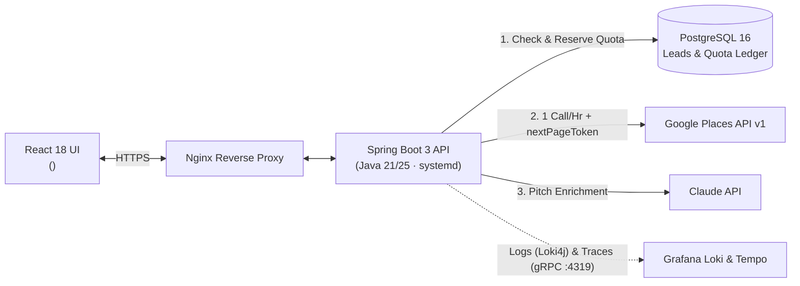

# How I Solve Engineering Problems — Case Studies from Building Hitlist

Hi, I'm Thabo. I built **Hitlist**—a full-stack Java/Spring Boot and React app that finds local businesses without websites (like plumbers, clinics, and contractors) so agencies can reach out and pitch them digital services.

Instead of just dropping a link to a large codebase, I put this repo together to share **five real engineering problems** I ran into while building and running Hitlist—what broke, why my first idea didn't work, how I tracked down the root cause, and how I fixed it.

**Tech Stack:** `Java 21/25` · `Spring Boot 3` · `PostgreSQL 16` · `Redis` · `React 18` · `TanStack Table v8` · `OpenTelemetry & Grafana (Loki/Tempo)` · `Linux systemd`

---

## 1. Five Real Problems I Solved

| # | Story | What Went Wrong | How I Fixed It |
| :-: | :--- | :--- | :--- |
| **01** | **[Keeping Google API Costs at $0](case-studies/01-keeping-google-api-costs-at-zero.md)** | Google capped free Places API calls at 1,000/month. On top of that, our early budget-pause logic accidentally created an infinite 15-minute retry loop that burned search quota while saving zero leads. | Built a pre-flight micro-dollar ledger in Postgres, capped runs to 1 call/hour (720/month), held onto `nextPageToken` to exhaust all pages before rotating (`iteration % total`), and switched to soft budget caps. |
| **02** | **[Dropping Mockito When Java 25 Broke Our Tests](case-studies/02-dropping-mockito-for-java-25.md)** | Upgrading to OpenJDK 25 LTS crashed every unit test with `Java 25 (69) is not supported by Byte Buddy` and threw `sun.misc.Unsafe` warnings. | Removed Mockito and Byte Buddy completely. Built a 70-line in-memory `ConcurrentHashMap` `JpaRepository` fake for fast unit tests (<50ms) and used Testcontainers Postgres for real database tests. |
| **03** | **[Debugging a Silent 0-Lead API Failure](case-studies/03-debugging-a-silent-api-failure.md)** | After migrating to Google's new `POST /v1/places:searchText` API, the pipeline finished in 200ms saying `0 leads generated, 0 errors`. | Tracked down 3 stacked bugs: Spring's `UriComponentsBuilder` turned `:searchText` into `/:searchText` (HTTP 404), a catch block swallowed the 404, and Jackson crashed on undocumented fields in Google's JSON. |
| **04** | **[Fixing React Table Flicker & Jumping Layouts](case-studies/04-fixing-react-table-flicker.md)** | Filtering or changing pages on the Leads and Outreach tables caused a harsh strobe effect and made the page footer jump up and down—even with TanStack Table v8. | Found that `<50ms` local API responses were flipping table opacity `1.0 -> 0.5 -> 1.0` like a camera flash. Built a shared `<DataTable />` with a subtle 2px top loading bar, steady row opacity, and fixed min-height. |
| **05** | **[Bare-Metal Deploys & Fixing Grafana Tracing](case-studies/05-bare-metal-logging-and-deploys.md)** | OpenTelemetry traces were failing with `Connection reset by peer`, Loki was rejecting logs with `HTTP 400`, and GitHub Actions SCP wildcards were dropping frontend files. | Configured OTel to use `grpc` on Tempo's custom port `4319`, disabled structured metadata for Loki v11 in `logback-spring.xml`, switched deploys to atomic `rsync`, and sandboxed the app in `systemd`. |

---

## 2. How the System Fits Together



---

## 3. Run the Code Yourself (Takes 3 Seconds)

If you want to see how I write code and tests without spinning up Docker, Postgres, or API keys, check out the [`code-proofs/`](code-proofs/) folder. It's a small, self-contained Maven project that runs the **Quota Guardrail Ledger**, **Campaign Permutation Engine**, and **Zero-Bytecode In-Memory Repository Fakes**.

```bash
cd code-proofs
mvn clean test
```

---

## 4. Live Repo Stats & Architecture Decisions (Auto-Synced)

Whenever I commit changes in my main `hitlist` repo, a Git hook automatically sanitizes and syncs the latest stats and Architecture Decision Records (ADRs) here.

<!-- AUTO-SYNC:METRICS:START -->
| Metric | Current Count | Notes |
| :--- | :--- | :--- |
| **Last Synced Commit** | `3a2129f` (`2026-09-01`) | Auto-synced via Git hook from main `hitlist` repo |
| **Backend Java Classes** | `118` | Spring Boot 3 (`auth`, `leads`, `outreach`, `fulfillment`, `integrations`) |
| **Zero-Bytecode Test & Fake Classes** | `33` | Pure Java in-memory `JpaRepository` fakes + Testcontainers |
| **Frontend React Components** | `28` | React 18 + TanStack Table v8 |
| **Architecture Decision Records** | `8` | Synced in [`docs/adr/`](docs/adr/README.md) |
<!-- AUTO-SYNC:METRICS:END -->

### Synced ADRs & Post-Mortems
<!-- AUTO-SYNC:ADR-INDEX:START -->
| ID | Decision / Post-Mortem | Type |
| :--- | :--- | :--- |
| **ADR-001** | [ADR 001: Data Table Flickering and Standardization](docs/adr/ADR-001-DataTable-Flickering-Resolution.md) | ADR |
| **ADR-002** | [ADR 002: Search Campaign Permutations & Free-Tier Deep Exhaustion](docs/adr/ADR-002-Search-Campaign-Permutations.md) | ADR |
| **ADR-003** | [ADR 003: Zero-Bytecode Test Architecture & Testcontainers Integration](docs/adr/ADR-003-Zero-Bytecode-Architecture-and-Testcontainers.md) | ADR |
| **ADR-004** | [ADR 004: Automated Architecture Showcase & 4-Layer Cross-Repository Synchronization](docs/adr/ADR-004-Automated-Showcase-Portfolio-Synchronization.md) | ADR |
| **ADR-005** | [Implementation Document: Dynamic Lead Generation Configuration & Architecture](docs/adr/ADR-005-dynamic-config-architecture.md) | Post-Mortem / Spec |
| **ADR-006** | [Implementation Document: Upgrade to New Google Places API](docs/adr/ADR-006-google-places-new-api-upgrade.md) | Post-Mortem / Spec |
| **ADR-007** | [Post-Mortem: Google Places API Silent Failure & DTO Mapping](docs/adr/ADR-007-google-places-silent-failure.md) | Post-Mortem / Spec |
| **ADR-008** | [Lead Generation Pipeline Guardrails](docs/adr/ADR-008-lead-generation-guardrails.md) | Post-Mortem / Spec |
<!-- AUTO-SYNC:ADR-INDEX:END -->


