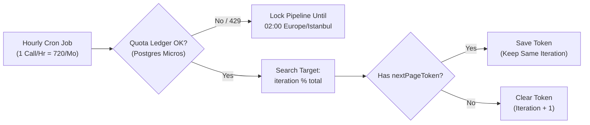

# 01: Keeping Google Places API Costs at $0 (While Rotating Across Dozens of Cities)

**Runnable Code in This Repo:** [`ApiQuotaGuardrailService.java`](../code-proofs/src/main/java/com/portfolio/hitlist/quota/ApiQuotaGuardrailService.java) · [`CampaignPermutationEngine.java`](../code-proofs/src/main/java/com/portfolio/hitlist/permutation/CampaignPermutationEngine.java)

## The Goal
Hitlist automatically searches Google Places for local businesses across different cities and categories (like *"Plumber in Istanbul"* or *"Dentist in London"*) to find businesses that don't have a website yet.

When Google updated its Maps billing, requesting phone numbers and website URLs fell under the **Enterprise SKU**, which strictly caps free usage at **1,000 calls per month**. I needed my background job to rotate across dozens of city/category combinations 24/7 without ever crossing 1,000 calls/month.

## What Went Wrong First (The 15-Minute Infinite Loop)
My first attempt used simple per-run counters in memory (`max-google-details-calls-per-run`). When a run hit that limit, the pipeline returned `paused = true`.

The problem? My `CronJobService` treated `paused = true` as a temporary rate limit and scheduled a retry 15 minutes later. When it woke up 15 minutes later:
1. Its in-memory counter reset to `0`.
2. It searched the exact same first page of Google Places results, hit the limit on the same candidates, returned `paused = true`, and scheduled *another* retry.
3. **Result:** It burned Google search calls every 15 minutes in an infinite loop while saving **zero new leads**.

## How I Fixed It

1. **Pre-Flight Micro-Dollar Ledger in Postgres (`GoogleApiQuotaService`):**
   Instead of counting calls in volatile JVM memory, I created a `google_api_daily_usage` table that tracks spend in micro-dollars (`$1 = 1,000,000 micros`) before any HTTP call leaves the server. If a call would exceed the daily budget—or if Google returns `OVER_QUERY_LIMIT`—the service flips `pipeline_enabled = false` in Postgres and schedules a resume for `02:00 Europe/Istanbul` the next day.
2. **1 Call Per Hour + Deep Pagination (`nextPageToken`):**
   I set the cron job to make **strictly 1 call per hour** (~720 calls/month, safely below the 1,000 cap). If a query has more than 20 results, Google returns a `nextPageToken`. I save that token in Postgres so the next hour's run pulls Page 2 of the *same* search instead of moving on too early.
3. **Stateless Modulo Rotation (`globalSearchIteration % totalPermutations`):**
   Once all pages for a city/category are exhausted (`nextPageToken == null`), the job increments `globalSearchIteration` and picks the next target using `iteration % totalPermutations`. That way, I can add or remove cities in the UI at any time without breaking a stateful cursor table.
4. **Soft Caps Instead of Hard Pauses:**
   For manual batch runs, hitting the Place Details limit no longer pauses the job. Instead, it degrades gracefully—saving the basic business lead without the extra `$0.025` details call and finishing the run cleanly (`paused = false`).

## Trade-Offs & Takeaway
* **Capped Speed for $0 Predictability:** Limiting background runs to 1 call/hour caps automated discovery at 20 leads/hour (480/day), which is plenty for an outreach team and guarantees a $0 Google bill.
* **Lesson Learned:** Never track financial quotas in application memory, and never reuse "transient retry" states (`paused = true`) for daily budget caps.
