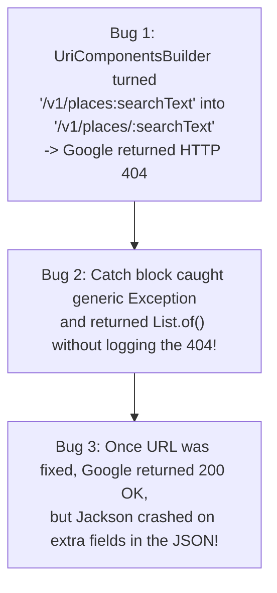

# 03: Debugging a Silent API Failure (0 Leads, 0 Errors)

## What Happened
Hitlist's whole purpose is finding local businesses **without websites**. Early on, I noticed my pipeline wasn't finding many 0-website leads. After testing manually, I realized the legacy Google Places API (`/maps/api/place/textsearch/json`) heavily favored businesses that *already* had websites.

Google's **New Places API v1 (`POST /v1/places:searchText`)** didn't have that bias—it returned plenty of brand-new local businesses without websites. So I updated `GooglePlacesHttpClient` to call the new v1 endpoint.

Right after deploying the change, I triggered a run. The logs printed:
`Searching Google Places for category 'Plumber' in city 'Istanbul'...`
And 200ms later, the job finished with:
**`0 leads generated, 0 errors`** (`status = "success"`).

## How I Tracked Down 3 Stacked Bugs

Why would a broken API call report `0 leads` and `0 errors`? It turned out three separate bugs were hiding behind each other:

1. **Bug 1 — Spring's URL Builder Added an Unwanted Slash:**
   Google's new v1 endpoint uses a colon action (`:searchText`) instead of a slash. When I passed `:searchText` into Spring's `UriComponentsBuilder`, it assumed a `/` was missing and quietly rewrote the URL to `/v1/places/:searchText`. Google immediately returned **HTTP 404 Not Found**.
2. **Bug 2 — A Swallowed Exception in the Fallback Block:**
   So a single failed city wouldn't crash a whole multi-city run, the pipeline had a `catch (Exception ex)` block that returned an empty `List.of()` if the error wasn't a billing lockdown. Because it didn't log `LOG.error(..., ex)`, the 404 vanished without a trace.
3. **Bug 3 — Strict Jackson Deserialization on Extra JSON Fields:**
   After I fixed the URL string and added proper error logging, Google returned `200 OK` with real JSON—and it *still* failed on certain queries! Google occasionally includes extra metadata fields in its response that weren't in my DTOs, causing Jackson to throw an `UnrecognizedPropertyException`.

## How I Fixed It

1. **Manual URL String Assembly for `:searchText`:** I built `baseUrl + "/v1/places:searchText"` directly before passing it to the HTTP client so Spring wouldn't inject a slash before the colon.
2. **Tolerant DTOs (`@JsonIgnoreProperties(ignoreUnknown = true)`):** I added `@JsonIgnoreProperties(ignoreUnknown = true)` to all external response DTOs (`GooglePlacesNewSearchResponse`, `GooglePlaceNewApiResult`) plus a strict `X-Goog-FieldMask` header so I only request—and pay for—the fields I actually use.
3. **Kept the Blast Radius Inside `integrations/google`:** I mapped the new v1 DTOs right back into my existing `GooglePlaceSummary` domain records, so `LeadGenerationPipelineService` didn't have to change at all.

## Trade-Offs & Takeaway
* **Why I Isolated the New DTOs:** Mapping the new v1 JSON into my existing `GooglePlaceSummary` record meant writing a small adapter method, but it saved me from touching the core pipeline, database entities, or downstream tests.
* **Lesson Learned:** Fallback `catch` blocks that return empty collections (`List.of()`) without logging the underlying exception turn loud 5-minute bugs into silent 2-hour mysteries.
