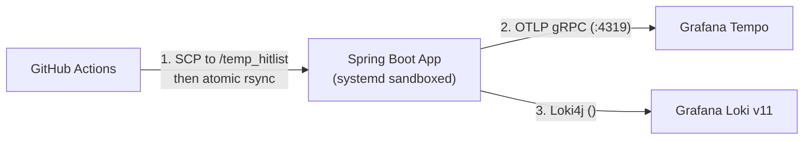

# 05: Bare-Metal Linux Deploys & Fixing Grafana (Loki/Tempo) Tracing

## What I Was Setting Up
To keep hosting costs low and own the full operational stack, I deployed Hitlist onto a bare-metal Ubuntu Linux server using **Nginx**, **`systemd`**, **GitHub Actions**, and a self-hosted **Grafana LGTM stack** (**L**oki for logs, **G**rafana for dashboards, **T**empo for distributed traces, and **P**rometheus for metrics).

Along the way, three tricky infrastructure bugs bit me in production.

## 3 Production Bugs & How I Solved Them

### 1. OpenTelemetry Traces Failing with `Connection reset by peer`
* **What Broke:** My Spring Boot app was running with the OpenTelemetry Java Agent, but zero traces were showing up in Grafana Tempo, and the logs were full of `Connection reset by peer`.
* **Root Cause:** Both Loki and Tempo wanted internal gRPC port `9095`, so I mapped Tempo's OTLP gRPC receiver to port **`4319`**. However, the OpenTelemetry Java Agent defaults to `http/protobuf` (which expects port `4318`), so it was sending HTTP/1.1 requests to a raw gRPC socket on `4319`.
* **The Fix:** Explicitly set `OTEL_EXPORTER_OTLP_PROTOCOL=grpc` alongside `OTEL_EXPORTER_OTLP_ENDPOINT=http://127.0.0.1:4319` in the service environment.

### 2. Grafana Loki Rejecting Logs with `HTTP 400 Bad Request`
* **What Broke:** My `Loki4j` Logback appender couldn't push logs to Loki—every batch failed with `400 Bad Request`.
* **Root Cause:** Newer versions of `Loki4j` automatically attach OpenTelemetry trace IDs as Loki **Structured Metadata**, which my Loki v11 schema rejected. Even worse, I initially put `<noStructuredMetadata>true</noStructuredMetadata>` inside the `<format>` block of `logback-spring.xml`, where XML binding silently ignored it.
* **The Fix:** Moved `<noStructuredMetadata>true</noStructuredMetadata>` to be a direct child of the `<appender>` tag in `logback-spring.xml`, and passed the trace ID via standard log labels instead.

### 3. GitHub Actions SCP Wildcards Silently Dropping Files
* **What Broke:** In my CI/CD workflow, using `appleboy/scp-action` with wildcards (`source: "frontend/dist/*"`) intermittently failed or skipped files, and `sudo systemctl restart hitlist` hung waiting for a password prompt.
* **The Fix:**
  1. Changed the deploy step to transfer the build to `/home/ubuntu/temp_hitlist` first and then run an atomic `rsync` over SSH into the live directory.
  2. Added a scoped `sudoers.d` rule for the deploy user and locked down `/etc/systemd/system/hitlist.service` with a dedicated non-root user (`hitlist-user`), `chmod 600` on `/etc/hitlist/.env`, `NoNewPrivileges=true`, `ProtectSystem=full`, and `ProtectHome=true`.

## Trade-Offs & Takeaway
* **Bare-Metal vs. Managed PaaS:** Running on a Linux VPS with `systemd`, Nginx, and self-hosted Grafana took more upfront debugging than clicking "Deploy" on a managed cloud service, but it cut monthly hosting and observability costs to a flat VPS bill while giving me full trace-to-log visibility.
