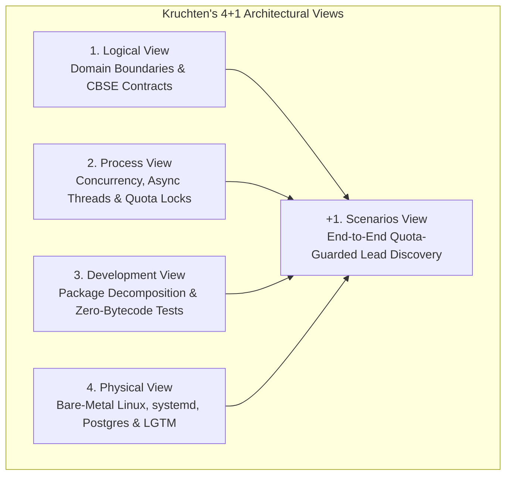
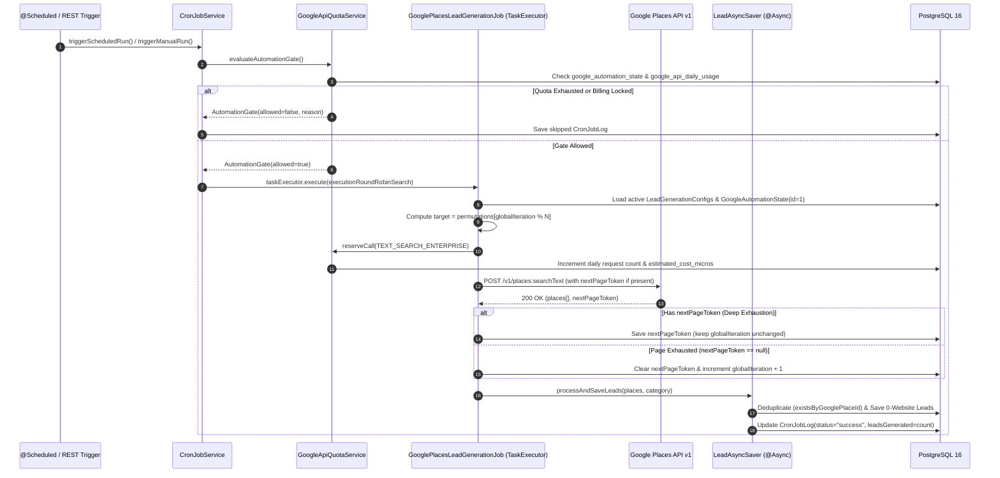
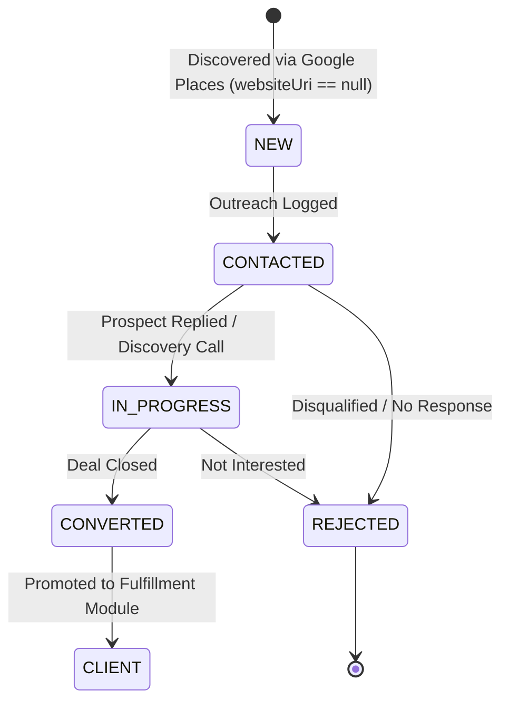

# System Architecture Specification (Kruchten's 4+1 View Model)

To prevent structural decay and ensure high dependability, the **SME Hitlist** platform is designed and documented across **Kruchten's 4+1 Architectural View Model**, enforcing strict **Component-Based Software Engineering (CBSE)** provides/requires contracts and **Swiss-Cheese Defensive Layering**.



---

## 1. Logical View (Domain Decomposition & CBSE Contracts)

The backend is partitioned into five self-contained domain modules under `com.hitlist.backend`. Each module communicates strictly through public **Provides** service interfaces and **Requires** repository/client sockets, hiding internal JPA entities and third-party HTTP wire formats behind anti-corruption mappers.

| Domain Module | Provides Interface (Public Operations) | Requires Interface (Dependencies) | Key Encapsulated Entities |
| :--- | :--- | :--- | :--- |
| **`auth` & `user`** | `AuthService` (`login`, `refresh`, `logout`), `JwtTokenService` (`issueTokens`, `parseAndValidate`) | `UserAccountRepository`, `RefreshTokenBlocklistRepository` | `UserAccount`, `RefreshTokenBlocklistEntry`, `UserLoginEvent` |
| **`leads`** | `LeadService`, `CronJobService`, `GooglePlacesLeadGenerationJob`, `LeadGenerationPipelineService` | `GooglePlacesClient`, `GoogleApiQuotaService`, `LeadRepository`, `LeadGenerationConfigRepository`, `CronJobLogRepository` | `Lead`, `LeadGenerationConfig`, `CronJobLog` |
| **`integrations.google`** | `GooglePlacesClient` (`searchPlaces`), `GooglePlacesService`, `GoogleApiQuotaService` (`reserveCall`, `evaluateAutomationGate`, `markBillingLockdown`) | `GoogleApiDailyUsageRepository`, `GoogleAutomationStateRepository`, External Google Places v1 REST API | `GoogleApiDailyUsage`, `GoogleAutomationState` (Singleton `id=1`) |
| **`integrations.claude`** | `ClaudeClient`, `LeadGenerationAiService` (`enrichLead`, `generateFallbackLeads`) | External Anthropic Messages API | Immutable DTO records (`ClaudeLeadEnrichmentRequest`, `ClaudeLeadEnrichmentResult`) |
| **`outreach`** | `OutreachService` (`logAttempt`, `getTodayQueue`, `updateStatus`) | `OutreachLogRepository`, `LeadRepository` | `OutreachLog` |
| **`fulfillment`** | `FulfillmentService` (`convertLeadToClient`, `createDeliveryNote`, `computeClientStats`) | `ClientRepository`, `DeliveryNoteRepository` | `Client`, `DeliveryNote` |

---

## 2. Process View (Concurrency, Scheduling & Transactional State Machines)

### A. Asynchronous Execution & Thread Isolation
To ensure manual API triggers (`POST /api/cron-logs/trigger`) and scheduled runs never block HTTP servlet threads:
1. **Pre-Flight Gate on Calling Thread:** `CronJobService` synchronously queries `GoogleApiQuotaService.evaluateAutomationGate()`. If the daily micro-dollar budget is exhausted or a billing lockdown is active, it immediately records a skipped log and returns HTTP 200 with the block reason.
2. **Background Round-Robin Dispatch:** When allowed, `CronJobService` dispatches `GooglePlacesLeadGenerationJob.executionRoundRobinSearch()` onto the Spring `applicationTaskExecutor` thread pool.
3. **Non-Blocking Lead Persistence (`@Async`):** Once the single hourly Google Places HTTP response returns (up to 20 places), `LeadAsyncSaver.processAndSaveLeads(...)` executes asynchronously via `CompletableFuture<Integer>`, deduplicating via `existsByGooglePlaceId` and persisting new 0-website SME leads in an isolated transaction.



### B. Lead Lifecycle State Machine


---

## 3. Development View (Source Organization & Zero-Bytecode V&V)

```text
hitlist/
├── backend-spring/
│   ├── pom.xml                                  # Excludes mockito-core & byte-buddy for JDK 25 LTS compatibility
│   └── src/
│       ├── main/java/com/hitlist/backend/       # Domain-driven modular packages
│       └── test/java/com/hitlist/backend/
│           ├── test/fakes/                      # Generic InMemoryJpaRepository<T,ID> & domain fakes
│           ├── test/ControllerTestHelper.java   # Standalone MockMvc builder with snake_case Jackson mapper
│           └── **/*Test.java                    # Unit tests (<50ms) & @Testcontainers PostgreSQL integration tests
├── frontend/
│   └── src/
│       ├── components/DataTable.jsx             # Standardized headless TanStack Table v8 component
│       └── pages/                               # LeadsPage, OutreachPage, FulfillmentPage, Config views
└── docs/                                        # Synchronized SRS, ADRs, Post-Mortems, and Operations Runbooks
```

---

## 4. Physical View (Bare-Metal Linux Deployment & Observability Topology)

The production environment runs on an Ubuntu Linux host engineered for high density, low overhead, and strict security isolation:

* **Edge Web Server (`nginx`):** Terminates TLS 1.2/1.3, serves the static React `dist/` bundle, and proxies `/api/*` traffic to the local Spring Boot loopback port.
* **Application Runtime (`hitlist.service`):** Managed by `systemd` under an unprivileged system user (`hitlist-user`, `/bin/false` shell) with kernel/filesystem sandboxing (`NoNewPrivileges=true`, `ProtectSystem=full`, `ProtectHome=true`, `600`-permission `/etc/hitlist/.env`).
* **Stateful Backing Services:** PostgreSQL 16 with PostGIS extension (connection-pooled via HikariCP) and Redis 7 bound strictly to `127.0.0.1`.
* **Grafana LGTM Observability Stack:**
  * **Logs:** `logback-spring.xml` ships logs directly via `Loki4j` to **Grafana Loki v11** (`<noStructuredMetadata>true</noStructuredMetadata>`).
  * **Traces:** The **OpenTelemetry Java Agent** exports distributed traces over gRPC (`OTEL_EXPORTER_OTLP_PROTOCOL=grpc`) to **Grafana Tempo** on custom port `4319`.
  * **Metrics:** Spring Boot Actuator + Micrometer expose JVM and HTTP latency histograms scraped by **Prometheus** and visualized in **Grafana**.

---

## 5. Scenarios (+1 View): Defensive Swiss-Cheese Layers in Action

Consider what happens when an operator configures 3 countries $\times$ 5 cities $\times$ 4 business categories (60 search permutations) and triggers automated discovery:

1. **Barrier 1 — Pre-Flight Quota Gate:** Before any network socket opens, `GoogleApiQuotaService.reserveCall(...)` atomically checks both the daily Enterprise SKU cap (`maxRequestsPerDay`) and the micro-dollar budget (`((monthlyCreditUsd * safetyRatio) / billingCycleDays) * 1_000_000`).
2. **Barrier 2 — Deep Pagination Before Rotation:** If "Plumbers in Istanbul, Turkey" returns 60 businesses across 3 pages, the job stores `nextPageToken` in `google_automation_state` and spends the next two hourly slots exhausting pages 2 and 3 before incrementing `globalSearchIteration`.
3. **Barrier 3 — Anti-Corruption DTO Deserialization:** `GooglePlacesHttpClient` requests only minimal `X-Goog-FieldMask` fields and parses responses using `@JsonIgnoreProperties(ignoreUnknown = true)`, shielding the domain pipeline from undocumented Google API schema additions.
4. **Barrier 4 — Automatic Billing Lockdown & Recovery:** If Google returns HTTP `429` or `OVER_QUERY_LIMIT`, `markBillingLockdown(...)` immediately flips `pipeline_enabled = false` and schedules `auto_resume_at` for `02:00 Europe/Istanbul` the following day, preventing cascading retry storms.
