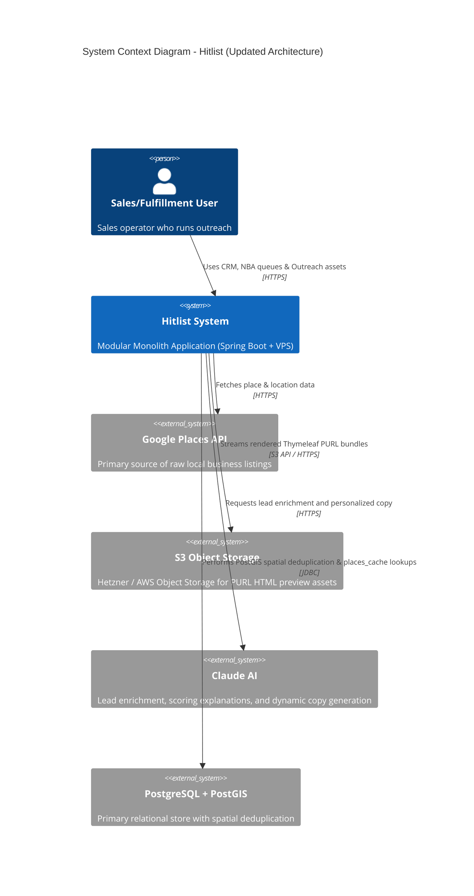
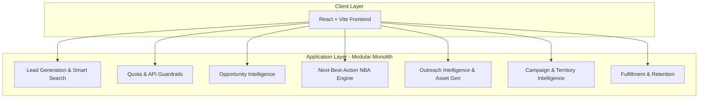
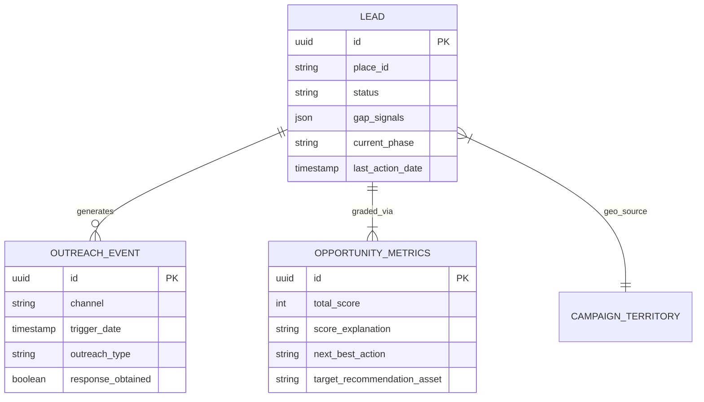
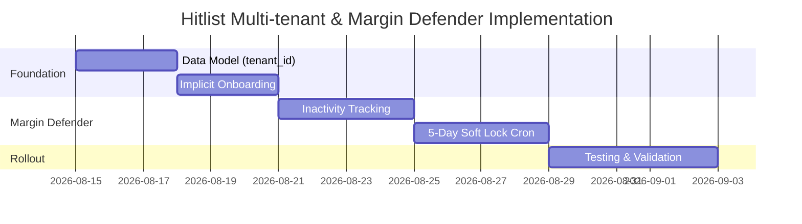

<!-- AUTO-SYNCED & SANITIZED FROM docs/srs/SRS.md (3a2129f) -->
> **Auto-Synced Baseline Specification** | Source: `docs/srs/SRS.md` @ `hitlist@3a2129f` (`2026-09-01 04:09:39 +0300`)
# Software Requirements Specification (SRS)

Product: Hitlist — Opportunity Intelligence & Sales Operating System
Document Version: 1.1
Date: August 2026

---

## 1. Executive Summary & Product Vision
Hitlist is a modular monolith designed to transform raw lead lists into prioritized, explainable opportunities with exact next actions for sales reps. It combines top-of-funnel generation (Google Places), spatial deduplication, AI enrichment, quota guardrails, opportunity scoring, next-best-action workflow queues, outreach collateral generation, and fulfillment/retention analytics.

Goals:
- Surface the highest-probability opportunities daily
- Protect API budgets and operating costs
- Provide transparent, auditable scoring and recommendations
- Automate outreach assets and task queues to increase conversion velocity

---

## 2. System Architecture & Context
The system is a Modular Monolith with a React/Vite SPA frontend, a Spring Boot backend, PostgreSQL + PostGIS primary store, Redis cache/queues, and background schedulers for enrichment and CRON jobs.

### 2.1 Application Layer (Modules)

---

## 3. Functional Requirements (per module)
Each module now follows the same high-level structure pattern used in `backend-spring/docs-aboina/srs/modules/*` (Overview, Definition, User Stories, Screens, Rules, Security, Performance, APIs, Success Metrics).

### Module 1: Lead Generation & Smart Search Engine

#### Overview
**Module Name:** Lead Generation & Smart Search Engine  
**Module ID:** MOD-001  
**Priority:** Critical (MVP)  
**Implementation Phase:** Phase 1 - Foundation  
**Dependencies:** Google Places API, PostGIS, Quota & API Guardrails

#### Definition
This module ingests, normalizes, and deduplicates lead data from external sources and supports geospatial search, filter, and retrieval workflows.

#### User Stories
| ID | User Story | Priority | Acceptance Criteria |
|----|------------|----------|-------------------|
| **US-LG01** | As a **sales operator**, I want to **ingest leads by location/category**, so that **I can build target lists quickly** | Must Have | • Google Places ingestion • Geospatial filters • Provenance captured • Cost event logged |
| **US-LG02** | As a **sales operator**, I want to **detect digital gaps automatically**, so that **I prioritize businesses with urgent needs** | Must Have | • Website checks • SSL checks • Review freshness • Hours consistency |
| **US-LG03** | As a **system admin**, I want to **deduplicate records spatially and fuzzily**, so that **the pipeline avoids duplicates** | Must Have | • PostGIS proximity match • Fuzzy name match • Confidence score • Cluster centroid |

#### Screens & Wireframes
- Search and filter panel (city, category, radius, source)
- Lead map/list result view with distance sorting
- Dedup review queue with confidence and merge actions

#### Business Rules
- **REQ-LEAD-001:** Integrate Google Places ingestion by geospatial targets.
- **REQ-LEAD-002:** Detect missing website, SSL, stale reviews, and inconsistent hours.
- **REQ-LEAD-003:** Execute spatial + fuzzy dedup before persisting.
- **REQ-LEAD-004:** Use fuzzy index caching to reduce repeated vendor calls.
- **REQ-GEO-01:** Apply Uber's H3 spatial index (via h3-java in JVM) for performant location clustering and territory assignments.
- **REQ-GEO-02:** Resolve exact spatial coordinates into PostGIS geometries during ingestion.
- **REQ-LIV-01:** Perform non-blocking, async HTTP/DNS checks (using Spring Boot 3 WebClient/Virtual Threads) to establish digital liveness.
- **REQ-LIV-02:** Capture SSL cert validity and domain expiration as part of the liveness pipeline.

#### Security Requirements
- Log billable calls with tenant/user attribution.
- Encrypt lead enrichment payloads at rest.
- Apply strict input validation to search parameters.

#### Performance Requirements
| Metric | Target |
|--------|--------|
| Cached geospatial search | < 1 second |
| Dedup decision response | < 800 ms |
| Ingest write persistence | < 2 seconds per lead |

#### API Endpoints
| Method | Endpoint | Description |
|--------|----------|-------------|
| GET | `/api/places/search` | Search external places by city/category/radius |
| POST | `/api/leads/ingest` | Ingest selected place into lead store |
| POST | `/api/leads/dedup` | Evaluate candidate duplicates |

#### Success Metrics (KPIs)
- Duplicate ingestion rate < 1%
- Cost-per-ingested qualified lead reduced month over month
- 95th percentile cached searches under 1 second

---

### Module 2: Quota & API Guardrails

#### Overview
**Module Name:** Quota & API Guardrails  
**Module ID:** MOD-002  
**Priority:** Critical (MVP)  
**Implementation Phase:** Phase 1 - Foundation  
**Dependencies:** Lead Generation, Admin telemetry

#### Definition
This module protects API spend with pre-flight quota enforcement, dynamic allocation controls, and operational burn-rate visibility.

#### User Stories
| ID | User Story | Priority | Acceptance Criteria |
|----|------------|----------|-------------------|
| **US-QG01** | As a **finance owner**, I want to **set hard monthly/daily limits**, so that **API costs stay controlled** | Must Have | • Monthly cap • Daily dynamic cap • Region-aware limits • Override controls |
| **US-QG02** | As a **system**, I want to **block over-budget requests pre-flight**, so that **overspend never executes** | Must Have | • Interceptor check • 429 response • Audit log • Alert trigger |
| **US-QG03** | As a **product manager**, I want to **reallocate unused budget**, so that **high-performing regions scale** | Should Have | • Reallocation endpoint • Recommendation hints • Approval log • Forecast impact |

#### Screens & Wireframes
- Budget dashboard (remaining, projected burn)
- Reallocation form and approval modal
- Quota incident log and trend chart

#### Business Rules
- **REQ-QUOTA-001:** Enforce monthly and dynamic daily budget caps.
- **REQ-QUOTA-002:** Use pre-flight interceptor to block threshold breaches.
- **REQ-QUOTA-003:** Allow controlled dynamic reallocation.
- **REQ-LIV-03:** Rate-limit asynchronous liveness checks to prevent IP blacklisting.

#### Additional Business Rules
- **REQ-QUOTA-004 (Storage Watchdog Guardrail):** Monitor local VPS disk usage daily. If PostgreSQL `places_cache` or local temp build directories push SSD usage past 85%, trigger an automated purge of
expired cache entries (> 30 days) and delete local temporary build artifacts.
- **REQ-QUOTA-005 (Object Storage Egress & Cap Control):** Track monthly upload volumes to AWS / Hetzner Object Storage to ensure operations stay strictly within developer free tier limits.

#### Security Requirements
- Restrict quota overrides to privileged roles.
- Record immutable audit trail for every change.
- Alert on anomalous burst usage patterns.

#### Performance Requirements
| Metric | Target |
|--------|--------|
| Quota check overhead | < 50 ms/request |
| Dashboard refresh | < 2 seconds |
| Reallocation commit | < 1 second |

#### API Endpoints
| Method | Endpoint | Description |
|--------|----------|-------------|
| GET | `/api/quota/status` | Current quota, burn, projection |
| POST | `/api/quota/reallocate` | Reallocate budget by region/provider |

#### Success Metrics (KPIs)
- Accidental overrun prevention > 99.9%
- Daily burn prediction error < 10%
- Quota-related incidents trend down month over month

---

### Module 3: Opportunity Intelligence (Scoring & Explainability)

#### Overview
**Module Name:** Opportunity Intelligence  
**Module ID:** MOD-003  
**Priority:** Critical (MVP)  
**Implementation Phase:** Phase 2 - Intelligence  
**Dependencies:** Lead Generation, Enrichment pipelines

#### Definition
This module computes deterministic opportunity scores, routes opportunities by priority tier, and produces explainable reasoning for every score.

#### User Stories
| ID | User Story | Priority | Acceptance Criteria |
|----|------------|----------|-------------------|
| **US-OI01** | As a **sales rep**, I want to **see a reliable score per lead**, so that **I prioritize likely conversions** | Must Have | • 0–100 score • Tier mapping • Repeatable output • Fast retrieval |
| **US-OI02** | As a **manager**, I want to **understand why each score was assigned**, so that **the model is auditable** | Must Have | • Plain summary • Feature contributions • Top factors listed • Traceability |
| **US-OI03** | As a **sales rep**, I want to **receive offer recommendations**, so that **my outreach matches the lead's weakness** | Should Have | • Offer mapping • Vertical fit • Rationale note • Editable suggestion |

#### Screens & Wireframes
- Scorecard panel (score, tier, trend)
- Explainability drawer (feature contributions)
- Offer recommendation block on lead detail

#### Business Rules
- **FR-OI-001:** Deterministic 0–100 scoring from configured features.
- **FR-OI-002:** Tier routing into A/B/C priority classes.
- **FR-OI-003:** Human-readable and machine-readable explanations.
- **FR-OI-004:** Offer recommendation tied to detected weakness.
- **REQ-LIV-04:** Deprioritize or penalize opportunities that fail consecutive DNS liveness checks.

#### Security Requirements
- Version and sign model/weights configuration changes.
- Prevent unauthorized score recomputation triggers.
- Mask sensitive enrichment attributes in logs.

#### Performance Requirements
| Metric | Target |
|--------|--------|
| Cached score response | < 200 ms |
| Full re-score | < 1 second |
| Explanation generation | < 400 ms |

#### API Endpoints
| Method | Endpoint | Description |
|--------|----------|-------------|
| GET | `/api/opportunity/score` | Get score for a lead |
| POST | `/api/opportunity/bulk-score` | Bulk score lead set |
| GET | `/api/opportunity/explain` | Explain score factors |

#### Success Metrics (KPIs)
- Score reproducibility = 100% for same input snapshot
- Priority A conversion rate above baseline cohort
- Explainability usage adoption by reps > 70%

---

### Module 4: Next-Best-Action (NBA) Engine

#### Overview
**Module Name:** Next-Best-Action Engine  
**Module ID:** MOD-004  
**Priority:** Critical (MVP)  
**Implementation Phase:** Phase 2 - Intelligence  
**Dependencies:** Opportunity Intelligence, Outreach module

#### Definition
This module turns opportunity context into ordered work queues with due dates, reasoning, and workflow actions for reps and teams.

#### User Stories
| ID | User Story | Priority | Acceptance Criteria |
|----|------------|----------|-------------------|
| **US-NBA01** | As a **sales rep**, I want to **see my prioritized action queue**, so that **I execute the highest-impact tasks first** | Must Have | • Ranked queue • Due date • Priority labels • Context payload |
| **US-NBA02** | As a **sales rep**, I want to **complete/snooze tasks**, so that **my queue stays accurate** | Must Have | • Complete action • Snooze action • Outcome capture • Audit trail |
| **US-NBA03** | As a **manager**, I want to **surface win-back opportunities automatically**, so that **inactive leads are re-engaged** | Should Have | • 90-day trigger • Batch generation • Queue insertion • Monitoring |

#### Screens & Wireframes
- Rep queue board (Critical/Calls/Outreach/Follow-ups/At Risk)
- Task detail pane with rationale and suggested template
- Queue health widget for managers

#### Business Rules
- **FR-NBA-001:** Every active lead must map to one prioritized NBA task.
- **FR-NBA-002:** Due-date orchestrator manages task urgency categories.
- **FR-NBA-003:** Every task must include contextual reason text.
- **FR-NBA-004:** 90-day inactive leads must generate win-back tasks.
- **REQ-GEO-03:** Map tasks and route optimization using H3 indexing for field sales routing.

#### Security Requirements
- Enforce ownership/role checks on task updates.
- Track immutable history for all queue state transitions.
- Prevent tampering with due-date escalation rules.

#### Performance Requirements
| Metric | Target |
|--------|--------|
| Queue retrieval | < 300 ms |
| Task status update | < 200 ms |
| Win-back batch generation | < 5 minutes per daily run |

#### API Endpoints
| Method | Endpoint | Description |
|--------|----------|-------------|
| GET | `/api/nba/queue` | Retrieve prioritized user queue |
| POST | `/api/nba/complete` | Complete task with outcome |
| POST | `/api/nba/snooze` | Snooze task until date/time |

#### Success Metrics (KPIs)
- Daily queue completion rate
- Median time-to-first-action after task creation
- Win-back reactivation conversion rate

---

### Module 5: Outreach Intelligence & Conversion Asset Generator

#### Overview
**Module Name:** Outreach Intelligence & Conversion Asset Generator  
**Module ID:** MOD-005  
**Priority:** High (MVP+)  
**Implementation Phase:** Phase 3 - Conversion Optimization  
**Dependencies:** NBA Engine, Opportunity Intelligence

#### Definition
This module recommends channels, generates outreach assets, and orchestrates send flows to improve conversion velocity.

#### User Stories
| ID | User Story | Priority | Acceptance Criteria |
|----|------------|----------|-------------------|
| **US-OUT01** | As a **sales rep**, I want to **get best channel recommendations**, so that **my outreach has higher response rates** | Must Have | • Channel ranking • Vertical mapping • Geography context • Confidence label |
| **US-OUT02** | As a **sales rep**, I want to **generate personalized assets quickly**, so that **I can contact more leads with quality** | Must Have | • Template selection • Personalization merge • Preview rendering • Re-generate option |
| **US-OUT03** | As a **manager**, I want to **detect stale opportunities**, so that **teams can escalate before losing deals** | Should Have | • Time-in-state alerts • Escalation rules • Queue injection • Reporting |

#### Screens & Wireframes
- Asset generation form with template picker
- Preview panel for generated collateral
- Channel recommendation and escalation flags

#### Business Rules
- **FR-OUT-001:** Recommend primary channel by vertical/geography.
- **FR-OUT-002:** Render dynamic visual previews with lead merge data.
- **FR-OUT-003:** Detect and escalate stale opportunities.

#### Security Requirements
- Sanitize outbound template variables.
- Enforce opt-out/compliance constraints per channel.
- Log outbound payload metadata without storing secrets.

#### Performance Requirements
| Metric | Target |
|--------|--------|
| Cached asset render | ~2 seconds |
| Cold asset render | < 5 seconds |
| Channel recommendation | < 300 ms |

#### API Endpoints
| Method | Endpoint | Description |
|--------|----------|-------------|
| POST | `/api/outreach/generate` | Generate personalized outreach asset |
| POST | `/api/outreach/send` | Dispatch outreach payload |
| GET | `/api/outreach/templates` | Retrieve available templates |

#### Success Metrics (KPIs)
- Outreach response uplift vs control group
- Asset generation usage per rep per day
- Stale opportunity recovery rate

---

### Module 6: Campaign & Territory Intelligence

#### Overview
**Module Name:** Campaign & Territory Intelligence  
**Module ID:** MOD-006  
**Priority:** High (MVP+)  
**Implementation Phase:** Phase 3 - Conversion Optimization  
**Dependencies:** Lead Generation, Opportunity Intelligence, Analytics

#### Definition
This module measures campaign quality and territory performance using geospatial and conversion analytics to guide allocation decisions.

#### User Stories
| ID | User Story | Priority | Acceptance Criteria |
|----|------------|----------|-------------------|
| **US-CT01** | As a **manager**, I want to **view territory heatmaps**, so that **I identify high-yield regions** | Must Have | • Spatial clustering • Conversion overlays • Filter controls • Time windows |
| **US-CT02** | As a **manager**, I want to **track lead source quality**, so that **budget is moved to better channels** | Must Have | • Source breakdown • Conversion velocity • Trend lines • Export |
| **US-CT03** | As an **operations lead**, I want to **flag bottlenecks automatically**, so that **I can rebalance pipeline load** | Should Have | • Bottleneck alerts • Suggested actions • Segment-level insights • Weekly summary |

#### Screens & Wireframes
- Territory heatmap dashboard
- Campaign/source quality grid
- Bottleneck alert panel and recommendations

#### Business Rules
- **FR-TI-001:** Aggregate converted volume spatially by territory.
- **FR-CI-001:** Track conversion velocity by source/category/city.
- **FR-SI-002:** Detect and flag pipeline bottlenecks with recommendations.
- **REQ-GEO-04:** Pre-compute spatial clustering via PostGIS Materialized Views to enable rapid territory heatmaps.

#### Additional Business Rules
- **FR-TI-004 (Stateful Combination Offset):** Persist the exact `country_index`, `city_index`, and `category_index` offsets in `LeadGenerationConfig` when a run is paused (due to quota or rate-limits).
When execution resumes, the scheduler must pick up at the exact round-robin index where it left off, rather than restarting from index 0.

#### Security Requirements
- Enforce role-based access to territory-level commercial analytics.
- Redact client-sensitive fields in exports.
- Track audit events for report generation.

#### Performance Requirements
| Metric | Target |
|--------|--------|
| Heatmap render | < 2 seconds |
| Quality report query | < 3 seconds |
| CSV/PDF export generation | < 60 seconds |

#### API Endpoints
| Method | Endpoint | Description |
|--------|----------|-------------|
| GET | `/api/territories/performance` | Territory conversion performance |
| GET | `/api/campaigns/quality` | Campaign/source quality metrics |

#### Success Metrics (KPIs)
- Territory planning cycle time reduction
- Conversion lift in reallocated territories
- Campaign ROI trend improvement

---

### Module 7: Fulfillment & Retention Operations

#### Overview
**Module Name:** Fulfillment & Retention Operations  
**Module ID:** MOD-007  
**Priority:** High (MVP+)  
**Implementation Phase:** Phase 4 - Retention & Scale  
**Dependencies:** Payment data, Service delivery events, Reporting

#### Definition
This module tracks post-sale account health, automates monthly ROI reporting, and supports early churn prevention interventions.

#### User Stories
| ID | User Story | Priority | Acceptance Criteria |
|----|------------|----------|-------------------|
| **US-FUL01** | As an **account manager**, I want to **monitor MRR health by client**, so that **I intervene before churn risk increases** | Must Have | • Red/Yellow/Green score • Payment signals • Delivery gaps • Churn indicators |
| **US-FUL02** | As an **account manager**, I want to **send monthly ROI digests automatically**, so that **clients see delivered value** | Must Have | • Scheduled generation • KPI summary • Delivery tracking • Retry logic |
| **US-FUL03** | As a **leader**, I want to **analyze retention trends**, so that **I improve long-term revenue stability** | Should Have | • Cohort retention views • Expansion signals • Risk segmentation • Forecasts |

#### Screens & Wireframes
- Client health radar dashboard
- ROI digest preview and send history
- Retention cohort and churn risk analytics view

#### Business Rules
- **FR-FUL-001:** Daily MRR health scoring with traffic-light classification.
- **FR-FUL-002:** Monthly ROI digest generation on first business day.

#### Security Requirements
- Limit retention-financial views to authorized internal roles.
- Encrypt financial metrics and client identifiers at rest.
- Maintain immutable delivery/audit logs for generated digests.

#### Performance Requirements
| Metric | Target |
|--------|--------|
| Daily health calculation batch | < 30 minutes |
| Digest generation per client | < 10 seconds |
| Digest dispatch window | First 4 hours of first business day |

#### API Endpoints
| Method | Endpoint | Description |
|--------|----------|-------------|
| GET | `/api/fulfillment/mrr-health` | Client MRR health status |
| POST | `/api/fulfillment/digest/generate` | Generate monthly ROI digest |

#### Success Metrics (KPIs)
- Churn rate reduction
- On-time digest delivery rate > 99%
- Percentage of at-risk accounts recovered

---

## 4. Data Model Structure (Core objects)
ER overview (condensed):

Additional tables (examples):
- quota_usage (date, provider, calls, cost_cents)
- nba_tasks (id, lead_id, owner_id, due_date, priority, payload)
- enrichment_jobs (id, lead_id, engine, status, started_at, finished_at)

---

## 5. Business Logic & Constraints
- BR-001 (Hard Zero-Duplicate Protocol): Dedup via DB-first checks and fuzzy-index lookups before any billable external call.
- BR-002 (API Lock Constraint): Blocking of calls that violate rolling budget calc for current UTC window.
- BR-003 (Strict Activation Pathing): Lead status transitions require an attached NBA task as the activation proof.
- BR-004 (AI Role Isolation): AI outputs are advisory; canonical state and billing are authoritative from DB records.

---

## 6. Non-Functional Requirements (NFRs)
- NFR-001 (Reliability & Backoff): Exponential backoff and queueing to avoid vendor blacklists; idempotency for all external retries.
- NFR-002 (Data Security & Masking): Secrets stored in KMS; no secrets in repo. PII encrypted at rest and in transit.
- NFR-003 (Transactional Atomicity): Multi-row state changes (status + NBA task creation) executed in DB transactions with rollback.
- NFR-004 (Explainability & Audit): Scoring inputs and outputs logged for audit and reproducibility; plain-English reason field required for scores.
- NFR-005 (Performance Targets): Frontend CRM agenda queries <650ms; cached map loads <2s; API 95th percentile <500ms for core read endpoints.
- NFR-006 (Availability): 99.9% uptime SLA for core ingestion and NBA queueing services.
- NFR-007 (Liveness Latency): The HTTP liveness latency limit is strictly capped at a maximum of 3 seconds.
- NFR-008 (Performance): Asynchronous processing via Spring Boot 3-native solutions (WebClient/Netty or Java 21 Virtual Threads) must be utilized for high-throughput DNS/liveness resolution.
- NFR-009 (Resilience): Spatial query degradation must be prevented by delegating heavy calculations to h3-java in-memory structures or PostGIS Materialized Views.

Security & Compliance:
- API keys and provider credentials in environment or cloud secrets (KMS). Access via least privilege.
- Audit logs for all budget-impacting actions and lead state transitions.

---

## 7. Execution Roadmap & Sprint Plan
Sprints target delivering incremental, verifiable outcomes:
- Sprint 1–2 (Core Constraints): Spatial dedup, fuzzy matching, Postgres/PostGIS migration, quota burndown interceptors.
- Sprint 3–4 (AI Integration): Opportunity scoring, explainability, 90-day win-back CRON.
- Sprint 4.5 (Liveness & Geo): Integration of h3-java indexing, async DNS check pipelines, and PostGIS spatial views.
- Sprint 5–6 (Intelligent Workflows): NBA dashboard, pipeline backlog detection, outreach templates.
- Future: Predictive campaign suggestions, full MRR automation and client digests.

### 7.1 AI-Augmented Solo Execution Strategy
Given the team topology (1 Human Architect + AI Agent Swarm), the standard 4-month roadmap is heavily compressed to **6 - 8 weeks**. 
The division of labor shifts repetitive scaffolding to the AI, while the human focuses strictly on architectural verification.

- **Weeks 1-2 (Foundation)**: Agents scaffold the Spring Boot modular monolith and Hibernate `@TenantId` multi-tenancy. Solo dev reviews DB migrations and ensures flawless data isolation.
- **Weeks 3-4 (Complex Engines)**: Agents build WebClient/Virtual Thread liveness proxies and PostGIS spatial SQL. Solo dev architects Uber's `h3-java` integration and validates the strict 3-second latency caps.
- **Weeks 5-6 (Intelligence)**: Agents wire Claude AI and scaffold the React (Vite) frontend. Solo dev tunes prompt engineering to guarantee strict JSON output.
- **Weeks 7-8 (Polish)**: Agents build asset generators and heatmaps. Solo dev focuses on pixel-perfect UX and end-to-end integration testing.

**AI Engineering Constraints:**
To prevent silent technical debt and AI hallucination cascades, the solo developer must enforce strict `/plan`-driven development and frequent Git commits before authorizing any agent code execution.

---

## 8. Aboina docs — Inspiration mapping (summary)
- Maps & Navigation → Spatial dedup patterns, distance-based search, map UI affordances for lead visualization.
- Messaging System → Outreach channel patterns, templating, delivery receipts and scheduling.
- Analytics & Reporting → KPI dashboards, cohort analysis, scheduled report patterns for MRR and territory performance.
- Information Core → Scoring input design, personalization patterns and entity modelling.
- Admin Dashboard / Task Breakdown → Sprintable tasks, acceptance criteria and monitoring patterns.

---

## 9. Acceptance Criteria (Cross-module)
- All external-billable calls are audited with cost metadata.
- The NBA queue for a rep should be produced in <300ms and return contextual payloads.
- Opportunity scores must be reproducible and have a human-friendly explanation string.
- Budget guardrails must prevent >99.9% of accidental overruns in normal operation.

---

## 10. Multi-tenancy & Margin Defender Requirements
- **REQ-MULTI-001:** Core entities must be isolated by `tenant_id` to ensure strict data partitioning.
- **REQ-MARGIN-001:** Implement a soft lock mechanism (Margin Defender). If an account is inactive for 5 business days, send a notification and soft-lock until acknowledged.
- **REQ-ONBOARD-001:** Implicit onboarding. Pre-configured industry templates are applied implicitly during sign-up to streamline activation.

## 11. Gantt Chart (Implementation Plan)

---

For detailed, comprehensive per-module specifications, see:  
- [Module specs index](./modules/README.md)
- [Module 1: Lead Generation & Smart Search Engine](./modules/lead-generation-smart-search-engine.md)
- [Module 2: Quota & API Guardrails](./modules/quota-api-guardrails.md)
- [Module 3: Opportunity Intelligence (Scoring & Explainability)](./modules/opportunity-intelligence.md)
- [Module 4: Next-Best-Action (NBA) Engine](./modules/next-best-action-engine.md)
- [Module 5: Outreach Intelligence & Conversion Asset Generator](./modules/outreach-intelligence-conversion-asset-generator.md)
- [Module 6: Campaign & Territory Intelligence](./modules/campaign-territory-intelligence.md)
- [Module 7: Fulfillment & Retention Operations](./modules/fulfillment-retention-operations.md)

*Document prepared by Product & Architecture. Inspiration and structure adapted from backend-spring/docs-aboina SRS materials.*

