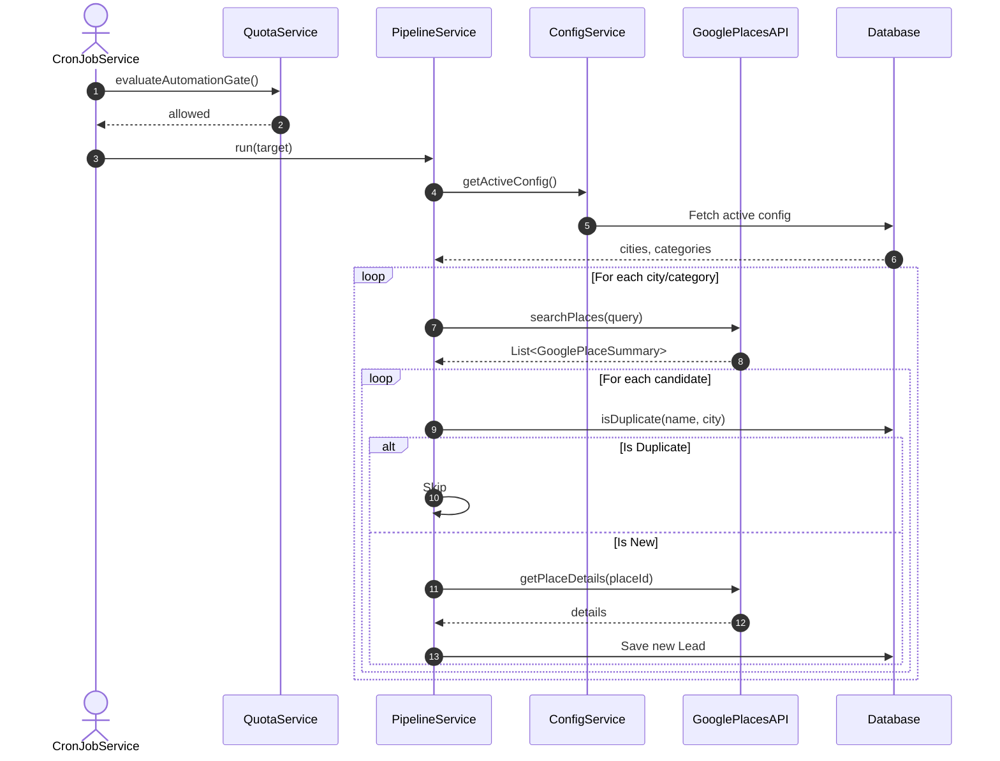
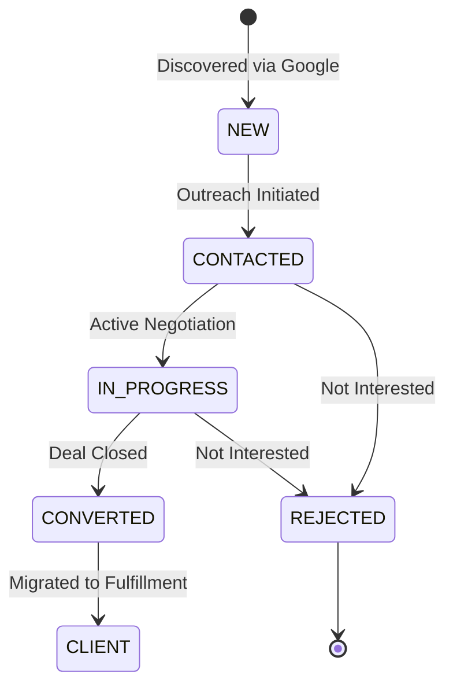

# Implementation Document: Dynamic Lead Generation Configuration & Architecture

## 1. Architecture Decision Record (ADR)
- **Context**: The user currently configures the lead generation target cities and categories within the static `application.yml` file. This requires codebase changes or environment variable modifications to search for different leads, and provides no history of past campaigns. Furthermore, there was a lack of visibility during manual cron job triggers, and no architecture documentation for the main modules.
- **Decision**: 
  1. We introduced a `LeadGenerationConfig` entity to the Postgres database to store reusable search configurations.
  2. We provided REST endpoints to manage and activate these configurations.
  3. We added comprehensive SLF4J logging to the `LeadGenerationPipelineService`.
  4. We created this document and embedded Mermaid.js diagrams to map out the system architecture natively in the repository.
- **Consequences**: The application is now more robust and user-friendly for non-technical users. The frontend can now be extended to allow users to click and select cities/categories to search. The tradeoff is slightly more complex logic in the pipeline service to fetch the active config, but the fallback to properties ensures backwards compatibility.

## 2. Sequence / State Diagrams

### Lead Generation Module Sequence


### Outreach & Fulfillment Module State


## 3. Data Flow & Mapping
When the frontend sends a configuration request, the data maps to the database as follows:

| Frontend JSON Field | Type | Backend Entity Field | Database Column |
| :--- | :--- | :--- | :--- |
| `name` | String | `LeadGenerationConfig.name` | `lead_generation_configs.name` |
| `cities` | String | `LeadGenerationConfig.cities` | `lead_generation_configs.cities` (varchar 2000) |
| `categories` | String | `LeadGenerationConfig.categories` | `lead_generation_configs.categories` (varchar 2000) |
| `setActive` | Boolean | `LeadGenerationConfig.isActive` | `lead_generation_configs.is_active` |

## 4. Testing Guidelines
To test the dynamic configuration:
1. Ensure the PostgreSQL database is running and connected via `application-local.yml`.
2. Start the Spring Boot backend.
3. Send a POST request to `/api/leads/configs` to create a new preset:
   ```json
   {
       "name": "Local Test Run",
       "cities": "Istanbul, Ankara",
       "categories": "Plumbers",
       "setActive": true
   }
   ```
4. Trigger the manual run endpoint or wait for the Cron job. You will see the new SLF4J logs outputting: `Using configuration - Cities: [Istanbul, Ankara], Categories: [Plumbers]`.

