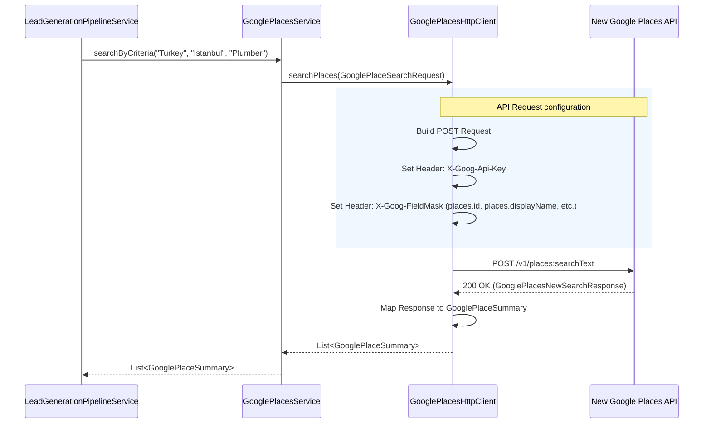

# Implementation Document: Upgrade to New Google Places API

## 1. Architecture Decision Record (ADR)

**Context:**
The core feature of the system is the Lead Generation Pipeline, which searches for businesses in specific cities and categories to identify those without websites as potential outreach leads. The application previously utilized the Old Google Places API (`/maps/api/place/textsearch/json`). However, this old API exhibited behavior where it heavily favored and exclusively returned places *with* existing websites, fundamentally breaking the pipeline's ability to find 0-website leads. Manual testing confirmed that the New Google Places API (`/v1/places:searchText`) provides comprehensive results without this bias.

**Decision:**
We migrated the Google Places integration (`GooglePlacesHttpClient`) from the legacy API to the New Google Places API.
- **Protocol**: Adopted the new `POST` requirement for text searches and updated the endpoint URLs.
- **Headers**: Implemented the mandatory `X-Goog-FieldMask` headers to explicitly request the necessary fields (e.g., `places.id`, `places.displayName`, `places.websiteUri`), keeping costs low by only requesting necessary Data SKUs.
- **DTOs**: Created new Data Transfer Objects (`GooglePlacesNewSearchRequest`, `GooglePlacesNewSearchResponse`, `GooglePlaceNewApiResult`) to handle the new JSON structure. 
- **Domain Models**: We intentionally preserved the existing internal domain models (`GooglePlaceSummary`, `GooglePlaceDetails`) and mapped the new DTOs into these models. This isolated the blast radius of the change to the `integrations/google` package and prevented cascading refactors in the `LeadGenerationPipelineService`.

**Consequences:**
- The lead generation pipeline can now successfully discover businesses without websites.
- The system must provide a valid `X-Goog-FieldMask`; failure to do so will result in API errors.
- Test suites (`GooglePlacesHttpClientTest` and `GooglePlacesServiceTest`) were fully rewritten to mock the new `POST` semantics and updated field expectations.

## 2. Sequence Diagrams

### Google Places Search Workflow



## 3. Data Flow & Mapping

The data fetched from Google Places must be accurately mapped to our domain entities so that the pipeline can evaluate the leads.

| Google Places API (New API Field) | Internal DTO (`GooglePlaceNewApiResult`) | Domain Model (`GooglePlaceSummary` / `GooglePlaceDetails`) |
|-----------------------------------|------------------------------------------|-----------------------------------------------------------|
| `id`                              | `id`                                     | `placeId`                                                 |
| `displayName.text`                | `displayName.getText()`                  | `name`                                                    |
| `formattedAddress`                | `formattedAddress`                       | `formattedAddress`                                        |
| `rating`                          | `rating`                                 | `rating`                                                  |
| `userRatingCount`                 | `userRatingCount`                        | `userRatingsTotal`                                        |
| `types`                           | `types`                                  | `types`                                                   |
| `websiteUri`                      | `websiteUri`                             | `website`                                                 |
| `nationalPhoneNumber`             | `nationalPhoneNumber`                    | `formattedPhoneNumber`                                    |
| `googleMapsUri`                   | `googleMapsUri`                          | `url` (Maps URL)                                          |

## 4. Testing Guidelines

To verify this implementation locally:

1. **Unit Tests**:
   Run the backend test suite to ensure the HTTP client gracefully handles the new payload structures and field masks.
   ```bash
   cd backend-spring
   mvn clean test
   ```

2. **Manual Pipeline Trigger**:
   - Ensure you have a valid Google Places API Key configured in your environment or local configuration (`application-local.yml`).
   - Trigger the lead generation cron job manually via the admin API.
   - Tail the logs. You should see the pipeline output: `Processing new candidate...` and successfully adding leads to the database when they do not possess a `websiteUri`.

3. **Check API Quota**:
   - Verify your Google Cloud Console to ensure the requests are hitting the `Places API (New)` and that billing is calculated based on the requested FieldMasks (e.g., Basic Data vs Contact Data).

