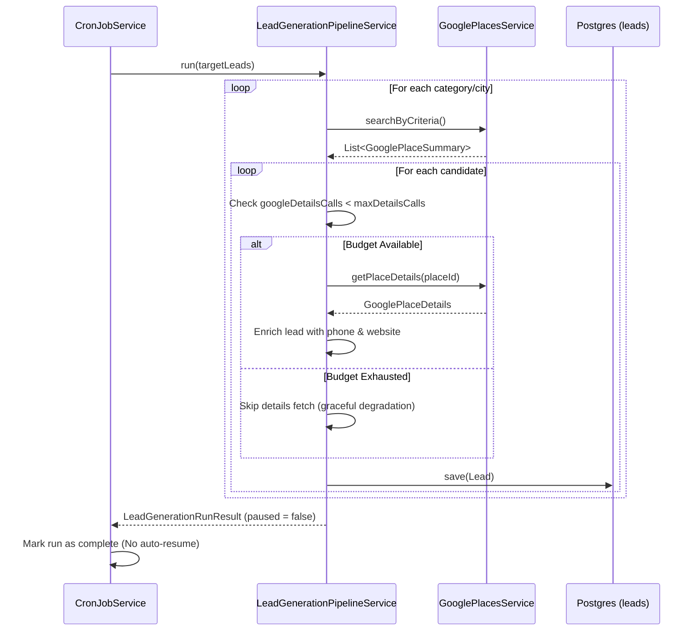

# Lead Generation Pipeline Guardrails

## Architecture Decision Record (ADR)

### Context
The SME Hitlist application automates lead generation using Google Places and AI services. To control costs, the system enforces per-run budget limits (e.g., `max-google-details-calls-per-run`, `max-google-search-calls-per-run`, and `max-ai-calls-per-run`). 

Previously, when these limits were reached, the `LeadGenerationPipelineService` returned a `paused=true` state. The `CronJobService` interpreted this as a temporary rate limit and scheduled an auto-resume 15 minutes later. However, upon resuming, the job reset its counters and immediately failed on the same candidates, resulting in an infinite auto-resume loop that generated zero leads and wasted resources.

Simultaneously, integration tests were failing due to missing in-memory database dependencies (H2) and incompatibilities between Testcontainers and the host's Docker Desktop environment.

### Decision
1. **Soft Caps for Budget Limits**: We converted the per-run budget limits from hard failures into soft degradation caps. If the Google Place Details budget is reached, the pipeline continues processing leads without fetching their details (omitting website and phone numbers). If the search or AI budget is reached, it gracefully exits or skips enrichment but still saves the generated leads and marks the run as successfully completed (`paused=false`).
2. **PostgreSQL for Tests**: We explicitly removed all Testcontainers and H2 configurations for tests, opting to point the `application-test.yml` directly to the local `hitlistdb` PostgreSQL instance (Option B) to mirror production behavior.
3. **Legacy API Retention**: We abandoned the migration to Google Places API v1 (New) to strictly maintain the cost predictability and tracking logic established for the legacy endpoints.

### Consequences
- **Positive**: The infinite resume loop is permanently resolved. API calls are no longer wasted.
- **Positive**: Integration tests run reliably against the actual target database dialect.
- **Negative/Trade-off**: Leads generated after the details budget is exhausted will lack phone numbers and website URLs until they are manually enriched or processed in a subsequent run.

---

## Sequence Diagram

The following diagram illustrates the updated logic flow when the Place Details budget is reached during a generation run.



---

## Data Flow & Mapping

When budget limits are hit, the backend mapping to the database adapts gracefully. Here is how the `Lead` fields are populated based on the available budget:

| Database Column (`leads` table) | Populated From | Behavior on Budget Exhaustion |
| :--- | :--- | :--- |
| `name` | `GooglePlaceSummary.name()` | Always populated |
| `city` | Pipeline Configuration | Always populated |
| `category` | Pipeline Configuration | Always populated |
| `google_rating` | `GooglePlaceDetails` (fallback to `Summary`) | Falls back to Search Summary rating |
| `google_review_count`| `GooglePlaceDetails` (fallback to `Summary`) | Falls back to Search Summary reviews |
| `phone` | `GooglePlaceDetails.formattedPhoneNumber()` | **NULL** (Skipped to save $0.025) |
| `notes` | `ClaudeLeadEnrichmentResult.summary()` | **NULL** (Skipped to save AI calls) |

---

## Testing Guidelines

To verify the implementation locally:

1. **Database Setup**: Ensure your local PostgreSQL instance is running on `localhost:5432` with the `hitlistdb` database created. The user should be `postgres` with the password `<REDACTED_SECRET>`.
2. **Run Tests**: Execute the integration test suite using Maven:
   ```bash
   ./mvnw clean test
   ```
3. **Manual Verification**: 
   - Temporarily set `LEAD_GEN_MAX_GOOGLE_DETAILS_CALLS_PER_RUN=1` in your `.env` file.
   - Trigger a manual lead generation via the API or frontend.
   - Verify in the database that the first lead has phone/website details, and subsequent leads in the same run have `NULL` for those fields.
   - Check the cron logs to ensure the run finished completely and did not schedule an auto-resume.

