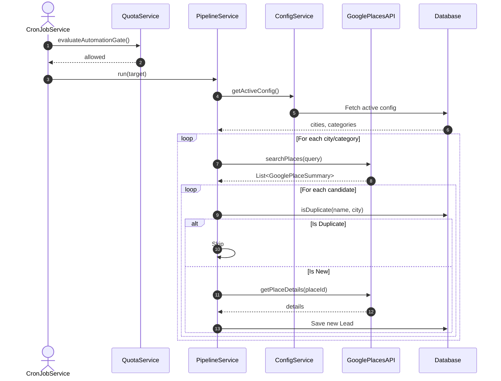
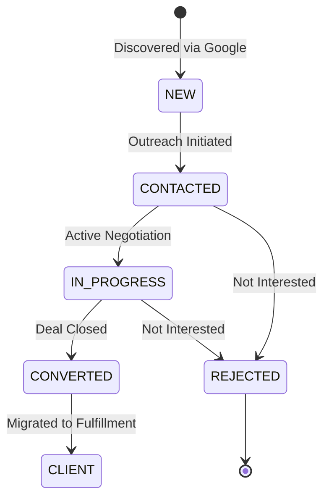
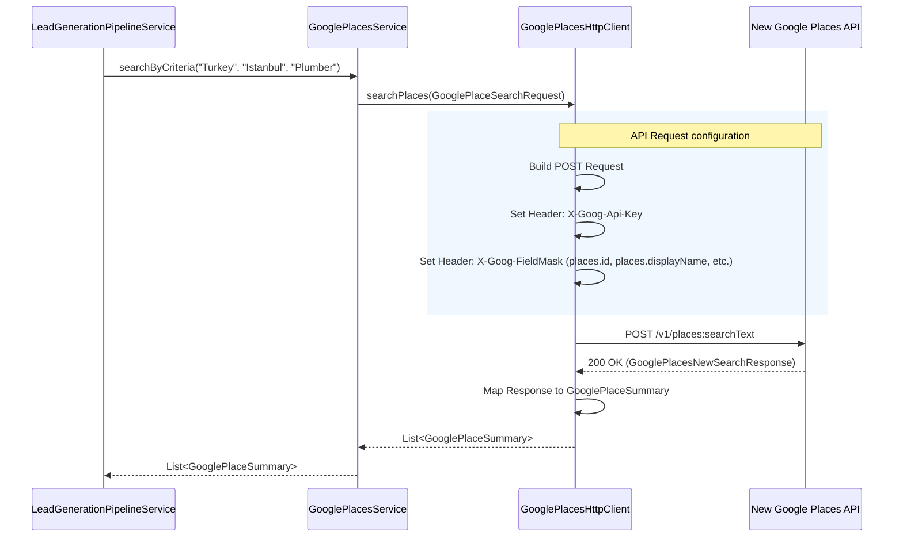
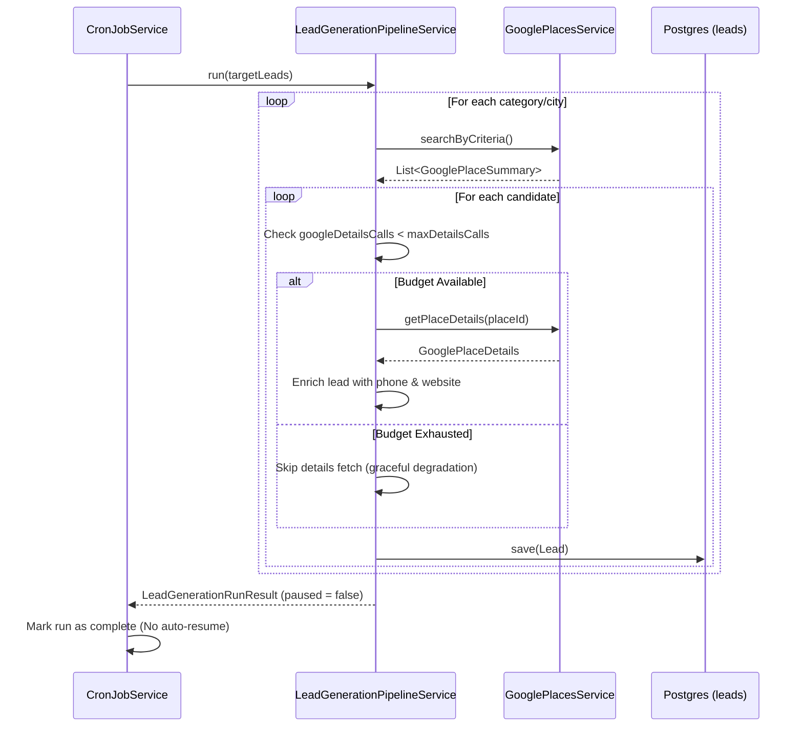

# Full Architecture Decision Record (ADR) & Post-Mortem Compendium

> **Auto-Synced & Sanitized from `hitlist@3a2129f` (`2026-09-01 04:09:39 +0300`)**  
> This single-file compendium consolidates all **8** production Architecture Decision Records and Post-Mortem write-ups for rapid Hiring Manager review.

---

## ADR-001: ADR 001: Data Table Flickering and Standardization
* **Category:** Architecture Decision Record | **Main Repo Source:** `docs/architecture/ADR-001-DataTable-Flickering-Resolution.md`

# ADR 001: Data Table Flickering and Standardization

## Context
The user reported persistent "flickering" on the Leads pipeline and Outreach tracker pages when applying filters, searching, or paginating. Despite migrating to TanStack Table (React Table v8) for state management, the visual flickering remained consistent across multiple views.

## Root Cause Analysis
The flickering is a UX/UI layer issue caused by three compounding factors during React re-renders:

1. **Fast-Fetch State Strobing:** When a user clicks a filter, the `loading` state is set to `true`. This instantly dropped the entire table's CSS `opacity` to `0.5`. Because the local API resolves almost instantly (often < 50ms), the state flips back to `false` and the opacity jumps back to `1.0`. This rapid `1.0 ➔ 0.5 ➔ 1.0` transition manifests as a jarring visual "flash" or "strobe" effect.
2. **Layout Shift (Height Collapse):** When moving between pages or filtering down a list (e.g., from 50 rows to 2 rows), the DOM removes the rows instantly. This causes the table container to collapse in height, pulling the `Pagination` component and page footer abruptly upward. 
3. **Redundant Re-renders:** Duplicated markup across `LeadsPage` and `OutreachPage` meant each table was managing its own container styles, loading states, and skeleton fallbacks inconsistently.

## Decision
To permanently resolve this and prepare for future modules (like Fulfillment), we will implement a standardized, reusable `<DataTable />` component.

### Architectural Standards for `<DataTable />`:
* **Headless Integration:** It will encapsulate TanStack's `useReactTable` internally.
* **Non-intrusive Loading UI:** Instead of dropping the opacity of the entire table (which causes the strobe effect), loading states will be indicated by a subtle indeterminate progress bar at the top of the table. The table contents will remain fully visible and at `1.0` opacity while background fetches occur.
* **Stable Dimensions:** The table container will enforce a `minHeight` or flex-grow property to ensure that filtering down to 0 or 2 results does not violently collapse the page layout.
* **Universal API:** It will accept `data`, `columns`, `loading`, and a `Pagination` object to be purely presentational.

## Consequences
* **Positive:** Developers no longer need to write complex table HTML/CSS grids for every new page. Flickering is universally solved.
* **Negative:** Pages must conform to the `<DataTable />` API contract, meaning slight refactoring of `LeadsPage` and `OutreachPage` is required to pass `columns` and `data` properly.

---

## ADR-002: ADR 002: Search Campaign Permutations & Free-Tier Deep Exhaustion
* **Category:** Architecture Decision Record | **Main Repo Source:** `docs/architecture/ADR-002-Search-Campaign-Permutations.md`

# ADR 002: Search Campaign Permutations & Free-Tier Deep Exhaustion

## Context
The system needed a way to endlessly generate unique leads by rotating through multiple active "Search Campaigns" (combinations of Country × City × Category).
Simultaneously, the Google Maps Platform transitioned to a per-SKU limit, strictly capping the Enterprise SKU (triggered by requesting phone numbers and websites) to **1,000 free events per month**.
We needed an algorithm that extracts the maximum possible unique leads from every combination without ever exceeding 1,000 requests per month.

## Decision
We implemented a **Deep Exhaustion + Mathematical Permutation** strategy inside the hourly Cron job.

1. **Strictly 1 Request Per Hour:** The `@Scheduled` cron job is hardcoded to execute exactly one Google Places API call per hour. Over a 30-day month, this translates to 720 calls, perfectly protecting the user from exceeding the 1,000 free event limit.
2. **Deep Exhaustion:** If a query yields more than 20 results, Google provides a `nextPageToken`. The backend stores this token in `GoogleAutomationState`. The next hourly run will use that token to fetch page 2 instead of starting a new query.
3. **Mathematical Permutation:** Once all pages for a combination are exhausted (the token is null), the system mathematically calculates the next target: `globalSearchIteration % total_permutations`. This allows for seamless rotation across multiple campaigns, cities, and categories without needing a complex state-tracking table.
4. **Multi-Campaign UI:** The frontend was updated to allow toggling multiple active campaigns concurrently.

## Consequences
* **Pros:** 
  * 100% guarantee of staying inside the free tier.
  * Stateless permutation makes it resilient to adding/removing cities mid-cycle.
  * Maximum extraction of leads per geographic area.
* **Cons:** 
  * Lead generation is strictly bounded to max 20 leads per hour (or 480 per day). For higher volume, the user will need to explicitly override the free tier protections or manually use the "Run Now" button.

---

## ADR-003: ADR 003: Zero-Bytecode Test Architecture & Testcontainers Integration
* **Category:** Architecture Decision Record | **Main Repo Source:** `docs/architecture/ADR-003-Zero-Bytecode-Architecture-and-Testcontainers.md`

# ADR 003: Zero-Bytecode Test Architecture & Testcontainers Integration

## Context
When running under modern Java LTS releases (specifically OpenJDK 25.0.2 LTS, classfile format version 69), dynamic bytecode manipulation frameworks such as Byte Buddy and Mockito failed with:
```
java.lang.IllegalArgumentException: Java 25 (69) is not supported by Byte Buddy
```
Furthermore, Byte Buddy's internal agent attachment mechanisms rely on terminally deprecated `sun.misc.Unsafe` methods slated for permanent removal in future JVM releases, resulting in runtime deprecation warnings and fragility across JDK upgrades.

Additionally, integration tests for controllers and persistence previously required authentic PostgreSQL schema validation and transactions rather than fragile mocked boundaries.

## Decision
We adopted **Option A: Pure Zero-Bytecode Architecture** paired with **Testcontainers PostgreSQL**:

1. **Complete Eradication of Bytecode Manipulation Dependencies:**
   - Excluded `mockito-core`, `mockito-junit-jupiter`, `byte-buddy`, and `byte-buddy-agent` from `spring-boot-starter-test` in `pom.xml`.
   - Replaced all Mockito `@Mock`, `when(...)`, `verify(...)`, and `@InjectMocks` usages with pure Java test doubles (stubs and in-memory repository fakes).

2. **In-Memory Component-Based Repository Fakes:**
   - Created reusable generic fakes: `InMemoryJpaRepository<T, ID>` and `InMemorySpecificationExecutorRepository<T, ID>` in `com.hitlist.backend.test.fakes`.
   - Implemented domain repository fakes (`FakeUserAccountRepository`, `FakeClientRepository`, `FakeLeadRepository`, `FakeDeliveryNoteRepository`, `FakeCronJobLogRepository`, `FakeOutreachLogRepository`, `FakeGoogleApiQuotaService`, etc.).
   - Standardized controller standalone setup via `ControllerTestHelper` with Spring Boot's snake_case Jackson naming convention and Java 8/JSR-310 datetime module.

3. **Authentic PostgreSQL Integration via Testcontainers:**
   - Added `org.springframework.boot:spring-boot-testcontainers` and `org.testcontainers:postgresql`.
   - Wired integration tests (`AuthControllerIntegrationTest`, `BackendSpringApplicationTests`) to dynamic PostgreSQL containers using `@Testcontainers` and `@ServiceConnection`.
   - Standardized Docker client configuration for modern Docker Desktop (Engine 29+, API 1.56) via `api.version=1.44` in `~/.docker-java.properties`.

## Consequences
* **Pros:**
  - **100% Java 25 LTS Compatibility:** Zero bytecode generation errors (`Java 25 (69)` is completely eliminated).
  - **Zero Deprecation Warnings:** No runtime dynamic agent loading or terminal `sun.misc.Unsafe` warnings from Byte Buddy.
  - **High Execution Velocity:** Unit tests execute in pure memory without reflection/bytecode synthesis overhead.
  - **High Integration Fidelity:** End-to-end authentication, JWT issuance, and JPA entity persistence execute against a genuine PostgreSQL 16 container matching production environments.
* **Cons:**
  - Test doubles (fakes) require manual maintenance if repository interfaces introduce new abstract query methods.
  - Integration tests require a running Docker daemon (e.g. Docker Desktop).

---

## ADR-004: ADR 004: Automated Architecture Showcase & 4-Layer Cross-Repository Synchronization
* **Category:** Architecture Decision Record | **Main Repo Source:** `docs/architecture/ADR-004-Automated-Showcase-Portfolio-Synchronization.md`

# ADR 004: Automated Architecture Showcase & 4-Layer Cross-Repository Synchronization

## Context
Engineering hiring managers, staff engineers, and technical recruiters evaluating a software engineer's problem-solving capability need immediate, high-signal visibility into architectural trade-offs, root-cause diagnostics, production resiliency, and code quality—without having to configure complex local infrastructure or sift through operational noise.

However, maintaining a separate public engineering portfolio repository (`C:\Dev\hitlist-case-studies`) introduces two significant risks:
1. **Documentation Drift (Lehman's Law of Continuing Change):** As the primary production codebase (`C:\Dev\hitlist`) evolves with new ADRs, post-mortems, schema migrations, and test suites, a manually maintained showcase repository quickly becomes stale.
2. **Credential & IP Leakage Risk:** Copying operational runbooks, troubleshooting guides, or configuration examples directly from a working repository risks exposing local database passwords, API keys (`AIzaSy...`, `sk-ant-...`), or private host addresses.

## Root Cause
Traditional portfolio repositories treat case studies as static, one-off snapshots disconnected from the active development lifecycle and Git commit pipeline of the primary codebase.

## Decision
We implemented a **4-Layer Idempotent, Fail-Closed Synchronization Architecture** linking `C:\Dev\hitlist` (Main Repository) to `C:\Dev\hitlist-case-studies` (Public Architecture & Problem-Solving Showcase):

1. **Layer 1: Sanitizing Sync Engine (`scripts/sync-showcase-repo.ps1` & `scripts/sync-showcase-repo.sh`)**
   - Automatically extracts live engineering telemetry from `C:\Dev\hitlist` (ADR count, backend Java source/test/fake counts, frontend component counts, SRS modules, and latest commit SHA/timestamp).
   - Updates bounded auto-sync blocks (`<!-- AUTO-SYNC:METRICS:START --> ... <!-- AUTO-SYNC:METRICS:END -->`) in `README.md` and `docs/EXECUTIVE_BRIEF.md` while preserving curated problem-solving narratives.
   - Consolidates and sanitizes all ADRs (`docs/architecture/ADR-*.md`) and implementation post-mortems (`docs/tasks/implementation/*.md`) into individual `docs/adr/ADR-xxx.md` files and a unified `docs/adr/FULL_ADR_CATALOG.md`.
   - Enforces a **fail-closed regex secret scrubber** that redacts sensitive patterns (`<REDACTED_SECRET>`) before writing to disk and aborts the commit if any unredacted credential pattern is detected.
2. **Layer 2: Version-Controlled Local Git Hooks (`.githooks/post-commit` & `.githooks/pre-push`)**
   - Configured via `git config core.hooksPath .githooks` so every local `git commit` and `git push` automatically synchronizes `C:\Dev\hitlist-case-studies`.
3. **Layer 3: GitHub Actions Cross-Repo Pipeline (`.github/workflows/sync-showcase.yml`)**
   - Executes `scripts/sync-showcase-repo.sh` on `main` branch pushes, verifying sanitization in CI and pushing updates to the remote showcase repository when `SHOWCASE_REPO_TOKEN` is configured.
4. **Layer 4: Continuous AI Agent Enforcement (`AGENTS.md`, `GEMINI.md`, & `scripts/verify-doc-sync.ps1`)**
   - Embeds `verify-doc-sync.ps1` into the mandatory Definition of Done for all collaborative AI agent sessions.

## Consequences
* **Pros:**
  * **Zero Drift:** Every new ADR, post-mortem, or commit in `C:\Dev\hitlist` automatically updates the showcase repository's metrics and ADR catalog.
  * **Defense-in-Depth Secret Protection:** Regex scrubbing + post-sync audit prevents accidental credential disclosure.
  * **Dual-Audience Optimization:** Pairs 60-second recruiter executive summaries with 15-minute staff-engineer deep dives and a zero-setup runnable Maven proof module (`code-proofs/`).
* **Cons:**
  * Adds a lightweight (~1–2 second) post-commit hook execution step to local commits in `C:\Dev\hitlist`.

---

## ADR-005: Implementation Document: Dynamic Lead Generation Configuration & Architecture
* **Category:** Implementation & Post-Mortem Record | **Main Repo Source:** `docs/tasks/implementation/dynamic-config-architecture.md`

# Implementation Document: Dynamic Lead Generation Configuration & Architecture

## 1. Architecture Decision Record (ADR)
- **Context**: The user currently configures the lead generation target cities and categories within the static `application.yml` file. This requires codebase changes or environment variable modifications to search for different leads, and provides no history of past campaigns. Furthermore, there was a lack of visibility during manual cron job triggers, and no architecture documentation for the main modules.
- **Decision**: 
  1. We introduced a `LeadGenerationConfig` entity to the Postgres database to store reusable search configurations.
  2. We provided REST endpoints to manage and activate these configurations.
  3. We added comprehensive SLF4J logging to the `LeadGenerationPipelineService`.
  4. We created this document and embedded Mermaid.js diagrams to map out the system architecture natively in the repository.
- **Consequences**: The application is now more robust and user-friendly for non-technical users. The frontend can now be extended to allow users to click and select cities/categories to search. The tradeoff is slightly more complex logic in the pipeline service to fetch the active config, but the fallback to properties ensures backwards compatibility.

## 2. Sequence / State Diagrams

### Lead Generation Module Sequence


### Outreach & Fulfillment Module State


## 3. Data Flow & Mapping
When the frontend sends a configuration request, the data maps to the database as follows:

| Frontend JSON Field | Type | Backend Entity Field | Database Column |
| :--- | :--- | :--- | :--- |
| `name` | String | `LeadGenerationConfig.name` | `lead_generation_configs.name` |
| `cities` | String | `LeadGenerationConfig.cities` | `lead_generation_configs.cities` (varchar 2000) |
| `categories` | String | `LeadGenerationConfig.categories` | `lead_generation_configs.categories` (varchar 2000) |
| `setActive` | Boolean | `LeadGenerationConfig.isActive` | `lead_generation_configs.is_active` |

## 4. Testing Guidelines
To test the dynamic configuration:
1. Ensure the PostgreSQL database is running and connected via `application-local.yml`.
2. Start the Spring Boot backend.
3. Send a POST request to `/api/leads/configs` to create a new preset:
   ```json
   {
       "name": "Local Test Run",
       "cities": "Istanbul, Ankara",
       "categories": "Plumbers",
       "setActive": true
   }
   ```
4. Trigger the manual run endpoint or wait for the Cron job. You will see the new SLF4J logs outputting: `Using configuration - Cities: [Istanbul, Ankara], Categories: [Plumbers]`.

---

## ADR-006: Implementation Document: Upgrade to New Google Places API
* **Category:** Implementation & Post-Mortem Record | **Main Repo Source:** `docs/tasks/implementation/google-places-new-api-upgrade.md`

# Implementation Document: Upgrade to New Google Places API

## 1. Architecture Decision Record (ADR)

**Context:**
The core feature of the system is the Lead Generation Pipeline, which searches for businesses in specific cities and categories to identify those without websites as potential outreach leads. The application previously utilized the Old Google Places API (`/maps/api/place/textsearch/json`). However, this old API exhibited behavior where it heavily favored and exclusively returned places *with* existing websites, fundamentally breaking the pipeline's ability to find 0-website leads. Manual testing confirmed that the New Google Places API (`/v1/places:searchText`) provides comprehensive results without this bias.

**Decision:**
We migrated the Google Places integration (`GooglePlacesHttpClient`) from the legacy API to the New Google Places API.
- **Protocol**: Adopted the new `POST` requirement for text searches and updated the endpoint URLs.
- **Headers**: Implemented the mandatory `X-Goog-FieldMask` headers to explicitly request the necessary fields (e.g., `places.id`, `places.displayName`, `places.websiteUri`), keeping costs low by only requesting necessary Data SKUs.
- **DTOs**: Created new Data Transfer Objects (`GooglePlacesNewSearchRequest`, `GooglePlacesNewSearchResponse`, `GooglePlaceNewApiResult`) to handle the new JSON structure. 
- **Domain Models**: We intentionally preserved the existing internal domain models (`GooglePlaceSummary`, `GooglePlaceDetails`) and mapped the new DTOs into these models. This isolated the blast radius of the change to the `integrations/google` package and prevented cascading refactors in the `LeadGenerationPipelineService`.

**Consequences:**
- The lead generation pipeline can now successfully discover businesses without websites.
- The system must provide a valid `X-Goog-FieldMask`; failure to do so will result in API errors.
- Test suites (`GooglePlacesHttpClientTest` and `GooglePlacesServiceTest`) were fully rewritten to mock the new `POST` semantics and updated field expectations.

## 2. Sequence Diagrams

### Google Places Search Workflow



## 3. Data Flow & Mapping

The data fetched from Google Places must be accurately mapped to our domain entities so that the pipeline can evaluate the leads.

| Google Places API (New API Field) | Internal DTO (`GooglePlaceNewApiResult`) | Domain Model (`GooglePlaceSummary` / `GooglePlaceDetails`) |
|-----------------------------------|------------------------------------------|-----------------------------------------------------------|
| `id`                              | `id`                                     | `placeId`                                                 |
| `displayName.text`                | `displayName.getText()`                  | `name`                                                    |
| `formattedAddress`                | `formattedAddress`                       | `formattedAddress`                                        |
| `rating`                          | `rating`                                 | `rating`                                                  |
| `userRatingCount`                 | `userRatingCount`                        | `userRatingsTotal`                                        |
| `types`                           | `types`                                  | `types`                                                   |
| `websiteUri`                      | `websiteUri`                             | `website`                                                 |
| `nationalPhoneNumber`             | `nationalPhoneNumber`                    | `formattedPhoneNumber`                                    |
| `googleMapsUri`                   | `googleMapsUri`                          | `url` (Maps URL)                                          |

## 4. Testing Guidelines

To verify this implementation locally:

1. **Unit Tests**:
   Run the backend test suite to ensure the HTTP client gracefully handles the new payload structures and field masks.
   ```bash
   cd backend-spring
   mvn clean test
   ```

2. **Manual Pipeline Trigger**:
   - Ensure you have a valid Google Places API Key configured in your environment or local configuration (`application-local.yml`).
   - Trigger the lead generation cron job manually via the admin API.
   - Tail the logs. You should see the pipeline output: `Processing new candidate...` and successfully adding leads to the database when they do not possess a `websiteUri`.

3. **Check API Quota**:
   - Verify your Google Cloud Console to ensure the requests are hitting the `Places API (New)` and that billing is calculated based on the requested FieldMasks (e.g., Basic Data vs Contact Data).

---

## ADR-007: Post-Mortem: Google Places API Silent Failure & DTO Mapping
* **Category:** Implementation & Post-Mortem Record | **Main Repo Source:** `docs/tasks/implementation/google-places-silent-failure.md`

# Post-Mortem: Google Places API Silent Failure & DTO Mapping

## The Issue
After migrating to the New Google Places API (/v1/places:searchText), the Lead Generation Pipeline began silently failing—it would log "Searching Google Places..." and then instantly complete with 0 candidates and 0 errors.

## Root Causes
1. **URL Builder Edge-Case**: UriComponentsBuilder automatically prepends a / if it thinks one is missing. When it encountered :searchText as a path segment, it transformed our URL to /v1/places/:searchText instead of /v1/places:searchText. This caused Google to return a 404 Not Found.
2. **Missing Exception Visibility**: The pipeline caught Exception ex but didn't log the stack trace if it wasn't a recognized error type, meaning the 404 error was completely swallowed.
3. **Strict JSON Deserialization**: Once the URL was fixed, the API returned valid JSON. However, the payload contained extra undocumented fields (e.g., metadata, internal tags). By default, Spring's Jackson2ObjectMapper can fail when mapping JSON to POJOs (Data Transfer Objects) if it encounters unrecognized properties, resulting in a silent failure or List.of() return in our fallback logic.

## The Solution
1. **Explicit URL Concatenation**: Constructed the URL string manually (aseUrl + path) *before* parsing it into UriComponentsBuilder.
2. **Explicit Error Logging**: Added LOG.error(..., ex) inside LeadGenerationPipelineService to ensure any HTTP network failure is visibly logged.
3. **Resilient DTO Mapping**: Decorated the DTO classes (GooglePlacesNewSearchResponse, GooglePlaceNewApiResult) with @JsonIgnoreProperties(ignoreUnknown = true). This guarantees that if Google adds new fields to their API response in the future, our backend won't randomly crash trying to parse them.

## Best Practices & Resources
To prevent these types of mapping and silent failures in the future, consider the following best practices:

- **Always annotate API response DTOs with @JsonIgnoreProperties(ignoreUnknown = true)** when consuming external APIs. External providers frequently change payload schemas.
- **Never swallow exceptions**. Always log at least the x.getMessage() when catching a generic Exception.
- **Use UriComponentsBuilder carefully with custom REST verbs**. Standard REST assumes / demarcated paths; Google's custom :{verb} syntax breaks this assumption.

**Further Reading:**
- [Spring Boot: Jackson Configuration](https://docs.spring.io/spring-boot/docs/current/reference/html/howto.html#howto.spring-mvc.customize-jackson-objectmapper)
- [Google Places API: Text Search](https://developers.google.com/maps/documentation/places/web-service/text-search)
- [RFC 3986: URI Generic Syntax](https://datatracker.ietf.org/doc/html/rfc3986)

---

## ADR-008: Lead Generation Pipeline Guardrails
* **Category:** Implementation & Post-Mortem Record | **Main Repo Source:** `docs/tasks/implementation/lead-generation-guardrails.md`

# Lead Generation Pipeline Guardrails

## Architecture Decision Record (ADR)

### Context
The SME Hitlist application automates lead generation using Google Places and AI services. To control costs, the system enforces per-run budget limits (e.g., `max-google-details-calls-per-run`, `max-google-search-calls-per-run`, and `max-ai-calls-per-run`). 

Previously, when these limits were reached, the `LeadGenerationPipelineService` returned a `paused=true` state. The `CronJobService` interpreted this as a temporary rate limit and scheduled an auto-resume 15 minutes later. However, upon resuming, the job reset its counters and immediately failed on the same candidates, resulting in an infinite auto-resume loop that generated zero leads and wasted resources.

Simultaneously, integration tests were failing due to missing in-memory database dependencies (H2) and incompatibilities between Testcontainers and the host's Docker Desktop environment.

### Decision
1. **Soft Caps for Budget Limits**: We converted the per-run budget limits from hard failures into soft degradation caps. If the Google Place Details budget is reached, the pipeline continues processing leads without fetching their details (omitting website and phone numbers). If the search or AI budget is reached, it gracefully exits or skips enrichment but still saves the generated leads and marks the run as successfully completed (`paused=false`).
2. **PostgreSQL for Tests**: We explicitly removed all Testcontainers and H2 configurations for tests, opting to point the `application-test.yml` directly to the local `hitlistdb` PostgreSQL instance (Option B) to mirror production behavior.
3. **Legacy API Retention**: We abandoned the migration to Google Places API v1 (New) to strictly maintain the cost predictability and tracking logic established for the legacy endpoints.

### Consequences
- **Positive**: The infinite resume loop is permanently resolved. API calls are no longer wasted.
- **Positive**: Integration tests run reliably against the actual target database dialect.
- **Negative/Trade-off**: Leads generated after the details budget is exhausted will lack phone numbers and website URLs until they are manually enriched or processed in a subsequent run.

---

## Sequence Diagram

The following diagram illustrates the updated logic flow when the Place Details budget is reached during a generation run.



---

## Data Flow & Mapping

When budget limits are hit, the backend mapping to the database adapts gracefully. Here is how the `Lead` fields are populated based on the available budget:

| Database Column (`leads` table) | Populated From | Behavior on Budget Exhaustion |
| :--- | :--- | :--- |
| `name` | `GooglePlaceSummary.name()` | Always populated |
| `city` | Pipeline Configuration | Always populated |
| `category` | Pipeline Configuration | Always populated |
| `google_rating` | `GooglePlaceDetails` (fallback to `Summary`) | Falls back to Search Summary rating |
| `google_review_count`| `GooglePlaceDetails` (fallback to `Summary`) | Falls back to Search Summary reviews |
| `phone` | `GooglePlaceDetails.formattedPhoneNumber()` | **NULL** (Skipped to save $0.025) |
| `notes` | `ClaudeLeadEnrichmentResult.summary()` | **NULL** (Skipped to save AI calls) |

---

## Testing Guidelines

To verify the implementation locally:

1. **Database Setup**: Ensure your local PostgreSQL instance is running on `localhost:5432` with the `hitlistdb` database created. The user should be `postgres` with the password `<REDACTED_SECRET>`.
2. **Run Tests**: Execute the integration test suite using Maven:
   ```bash
   ./mvnw clean test
   ```
3. **Manual Verification**: 
   - Temporarily set `LEAD_GEN_MAX_GOOGLE_DETAILS_CALLS_PER_RUN=1` in your `.env` file.
   - Trigger a manual lead generation via the API or frontend.
   - Verify in the database that the first lead has phone/website details, and subsequent leads in the same run have `NULL` for those fields.
   - Check the cron logs to ensure the run finished completely and did not schedule an auto-resume.

---

