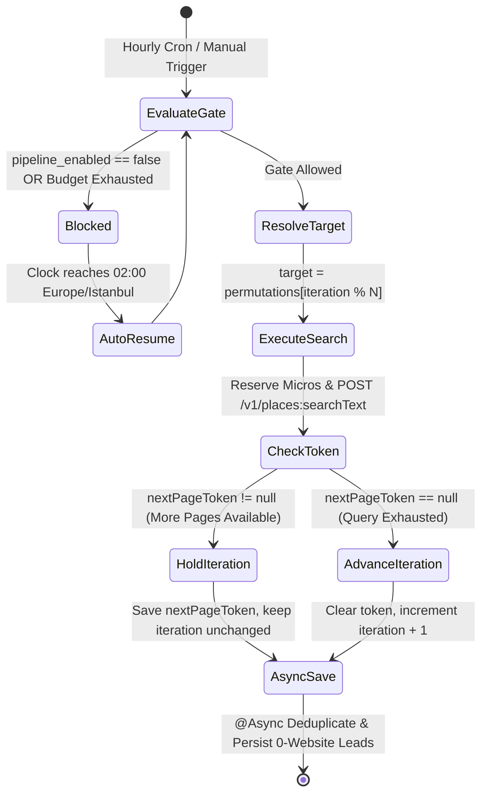

# Case Study 01: FinOps API Cost Guardrails, Deep Exhaustion & Stateless Modulo Permutation

> **Engineering Pillars:** Distributed State Machines · FinOps & Cost Governance · Algorithmic Permutation · Fault-Tolerant Scheduling  
> **Runnable Proof in This Repo:** [`ApiQuotaGuardrailService.java`](../../code-proofs/src/main/java/com/portfolio/hitlist/quota/ApiQuotaGuardrailService.java) & [`CampaignPermutationEngine.java`](../../code-proofs/src/main/java/com/portfolio/hitlist/permutation/CampaignPermutationEngine.java)

---

## 1. Context & Business Problem

**SME Hitlist** continuously discovers small and medium businesses across multiple geographic markets (`Country × City × Category`) that lack a web presence (`websiteUri == null`) so outreach teams can pitch digital services.

Two critical production constraints emerged simultaneously:
1. **Strict External SKU Cap:** Google Maps Platform transitioned to per-SKU billing where requesting contact fields (`websiteUri`, `nationalPhoneNumber`) triggers the **Enterprise SKU**, capped strictly at **1,000 free requests per month** before incurring steep per-1,000-call charges.
2. **Multi-Campaign Exhaustion Requirement:** Users needed to activate multiple concurrent "Search Campaigns" (e.g., *Turkey Cities × Home Services* and *UK Cities × Dental Clinics*) and extract every available lead across multiple result pages without ever breaching the 1,000-call monthly ceiling.

---

## 2. Why Naive Approaches Failed (The Infinite Auto-Resume Loop)

### Failure Mode A: Per-Run Hard Stops Causing Infinite Auto-Resume Loops
Initially, cost control was implemented as per-run integer counters inside `LeadGenerationPipelineService` (`max-google-details-calls-per-run`, `max-google-search-calls-per-run`). When a run hit its per-run detail limit, the pipeline returned `paused = true` with `remainingTarget > 0`.

`CronJobService` interpreted `paused = true` as a transient rate limit and scheduled an automatic retry 15 minutes later (`tryScheduleResume`). Upon waking up 15 minutes later:
1. The job re-fetched the exact same initial search page from Google Places.
2. It iterated through the same initial candidates, exhausted its per-run counter again before reaching new leads, returned `paused = true`, and scheduled another run.
3. **Impact:** An infinite auto-resume loop that burned Google Places Search quota every 15 minutes while generating **zero new leads**.

### Failure Mode B: Shallow First-Page Polling & Stateful Cursor Fragility
A standard nested `for (country) -> for (city) -> for (category)` loop always starts at index `(0, 0, 0)` on each scheduled trigger and only inspects the first 20 results unless pagination state is persisted across runs. Furthermore, maintaining a stateful join table of `(campaign_id, city, category, completed_boolean)` broke whenever an operator added or removed a city mid-month.

---

## 3. Root-Cause Diagnosis

1. **Conflation of Transient Rate Limits with Budget Exhaustion:** Returning `paused = true` from a batch pipeline when a daily/run budget cap is reached violates state-machine determinism unless the budget window itself has reset.
2. **Lack of Pre-Flight Financial Accounting:** Counting calls in volatile JVM memory (`RunCounters`) fails across service restarts, manual API triggers, and concurrent worker threads. Cost reservation must occur **transactionally in PostgreSQL before the outbound HTTP socket is opened**.
3. **Coupling Iteration State to Mutable Collection Order without Token Retention:** Google Places returns up to 60 results per query across three pages of 20 via a short-lived `nextPageToken`. Moving to the next `(City, Category)` before exhausting `nextPageToken` leaves 67% of discoverable leads behind.

---

## 4. Architectural Solution

We replaced the fragile in-memory counters with a 3-part architecture:

### A. Pre-Flight Micro-Dollar Quota Ledger & Circuit Breaker (`GoogleApiQuotaService`)
We introduced two dedicated PostgreSQL state tables—`google_api_daily_usage` (keyed by `usage_date`) and `google_automation_state` (singleton row `id = 1`)—and converted all financial calculations to **integer micro-dollars (`1 USD = 1,000,000 micros`)** using `BigDecimal` ceiling rounding to eliminate floating-point drift:

$$\text{DailyBudget}_{\mu\$} = \left\lfloor \frac{\text{MonthlyCredit}_{\$} \times \text{SafetyRatio}}{\text{BillingCycleDays}} \times 10^6 \right\rfloor$$

$$\text{RequestCost}_{\mu\$}(\text{SKU}) = \left\lceil \frac{\text{PricePer1000}_{\$}(\text{SKU})}{1000} \times 10^6 \right\rceil$$

Before **every** outbound HTTP attempt:
1. `reserveCall(sku)` checks if `automation_state.pipeline_enabled` is `false` (and opportunistically re-enables it if `now >= auto_resume_at`).
2. It enforces a hard daily request cap for `TEXT_SEARCH_ENTERPRISE` (`currentRequests >= maxRequestsPerDay`).
3. It verifies `usage.estimatedCostMicros + requestCostMicros <= dailyBudgetMicros`.
4. If either threshold is breached—or if Google returns HTTP `402`/`403`/`429` or `OVER_QUERY_LIMIT` (`markBillingLockdown`)—the service atomically sets `pipeline_enabled = false`, records the exact block reason, and schedules `auto_resume_at` for **`02:00` in `Europe/Istanbul`** on the next calendar day.

### B. Deep Pagination Exhaustion + Stateless Modulo Permutation (`GooglePlacesLeadGenerationJob`)
To guarantee we never exceed 1,000 monthly calls while extracting 100% of multi-page results:
1. **Strictly 1 Call Per Hour:** The scheduler executes once per hour ($\approx 720 \text{ calls/month} < 1,000 \text{ free cap}$).
2. **Stateless Modulo Indexing:** Active campaigns are flattened into an ordered `List<SearchTarget>` matrix (`Country × City × Category`). The current target is resolved mathematically via:
   ```java
   int currentIndex = state.getGlobalSearchIteration() % allPermutations.size();
   SearchTarget target = allPermutations.get(currentIndex);
   ```
3. **Deep Exhaustion via `nextPageToken`:**
   - If Google's response contains a non-empty `nextPageToken`, the job persists `state.setNextPageToken(token)` and **does not increment** `globalSearchIteration`. The next hourly trigger automatically fetches Page 2 of the *same* `(Country, City, Category)`.
   - Only when `nextPageToken` is `null` (all pages exhausted) does the job clear the token and increment `globalSearchIteration + 1`.



### C. Soft-Cap Graceful Degradation (Eliminating the Auto-Resume Loop)
For batch pipeline runs (`LeadGenerationPipelineService`), we converted per-run detail and AI enrichment limits from hard pauses (`paused = true`) into **soft degradation caps**:
- When the Place Details budget is reached mid-run, the pipeline logs a warning, skips the `$0.025` details fetch, and still saves the discovered lead with its summary rating/address (`phone = NULL`), marking the run `paused = false` (`status = "success"`).

---

## 5. Production Trade-Offs & Verification

| Design Decision | Advantage | Trade-Off Accepted |
| :--- | :--- | :--- |
| **1 Call/Hour Hard Cadence + Deep Exhaustion** | 100% mathematical guarantee of staying within Google's 1,000-call/month Enterprise free tier (720 calls/30 days). | Maximum automated velocity is bounded to 20 leads/hour (480/day) unless an operator manually triggers additional runs. |
| **Stateless Modulo (`iteration % N`) over Join Table** | Adding or toggling campaigns in the UI never corrupts cursor foreign keys or requires backfilling state tables. | Toggling a campaign mid-cycle shifts the modulo index by the added permutation count (acceptable for continuous background rotation). |
| **Soft-Cap Degradation on Detail Enrichment** | Permanently eliminates the 15-minute infinite auto-resume loop and preserves discovered lead names/locations. | Leads saved after the details cap require a subsequent enrichment pass to populate phone numbers. |

### Verify This Architecture Locally
Run [`ApiQuotaGuardrailServiceTest.java`](../../code-proofs/src/test/java/com/portfolio/hitlist/quota/ApiQuotaGuardrailServiceTest.java) and [`CampaignPermutationEngineTest.java`](../../code-proofs/src/test/java/com/portfolio/hitlist/permutation/CampaignPermutationEngineTest.java):
```bash
cd code-proofs && mvn test
```
