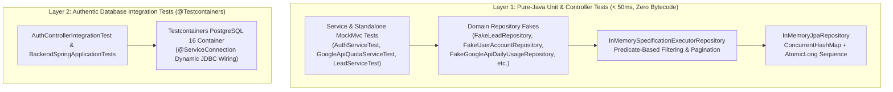

# Case Study 02: Zero-Bytecode Java 25 LTS Testing Architecture & Testcontainers Integration

> **Engineering Pillars:** JVM Internals & Forward Compatibility · Component-Based Software Engineering (CBSE) · Test Architecture (V&V)  
> **Runnable Proof in This Repo:** [`InMemoryRepository.java`](../../code-proofs/src/test/java/com/portfolio/hitlist/fakes/InMemoryRepository.java) & [`ApiQuotaGuardrailServiceTest.java`](../../code-proofs/src/test/java/com/portfolio/hitlist/quota/ApiQuotaGuardrailServiceTest.java)

---

## 1. Context & Technical Problem

While running the Spring Boot 3 backend verification suite under modern OpenJDK releases (specifically **OpenJDK 25.0.2 LTS**, classfile format version `69`), every unit and controller test utilizing `@Mock`, `@InjectMocks`, or `@MockBean` crashed during test initialization with:

```text
java.lang.IllegalArgumentException: Java 25 (69) is not supported by Byte Buddy
```

Simultaneously, JVM startup emitted critical runtime warnings regarding Byte Buddy's dynamic agent attachment mechanism (`byte-buddy-agent`), which relies on terminally deprecated `sun.misc.Unsafe` memory-mutation APIs slated for removal in future JDK releases (JEP 471 / JEP 498).

---

## 2. Why Naive Approaches Failed

### Naive Fix 1: Pinning or Downgrading the Developer JDK
Forcing all developer workstations and CI runners to downgrade the local JDK or pass `--add-opens` / `-XX:+EnableDynamicAgentLoading` JVM flags only masks the symptom:
1. It couples build stability to Byte Buddy's release cadence whenever a new JDK classfile version increments.
2. It leaves tests brittle: Mockito-heavy service tests (`when(repo.save(any())).thenReturn(...)`) test **mock choreography** rather than **actual state transitions**. For example, mocking `GoogleAutomationStateRepository.save(...)` does not verify that subsequent calls to `findById(1L)` within the same workflow observe the mutated `pipelineEnabled` and `autoResumeAt` state.

### Naive Fix 2: Using H2 In-Memory Database for All Unit Tests
Replacing Mockito with an in-memory H2 SQL database for every unit test introduces two problems:
1. Bootstrapping a full Spring JPA `ApplicationContext` adds multi-second startup overhead to fast unit tests.
2. H2's SQL dialect diverges from production **PostgreSQL 16 + PostGIS** on JSONB columns, spatial types, and transaction isolation semantics.

---

## 3. Root-Cause Diagnosis

The root architectural flaw was relying on **runtime bytecode generation (`ByteBuddy` / `Mockito`)** to synthesize test doubles for interfaces that already follow clean Component-Based Software Engineering (CBSE) contracts (`JpaRepository<T, ID>`, `JpaSpecificationExecutor<T>`, and service interfaces).

When components communicate strictly through well-defined **Provides/Requires interfaces**, test doubles do not need reflection or classfile instrumentation—they can be implemented as **stateful, pure-Java in-memory fakes** for unit tests, paired with **real PostgreSQL 16 containers via Testcontainers** for end-to-end integration tests.

---

## 4. Architectural Solution

We executed **ADR-003: Pure Zero-Bytecode Test Architecture**, structured across three layers:



### A. Complete Eradication of Bytecode-Manipulation Dependencies
In `backend-spring/pom.xml`, we explicitly excluded `mockito-core`, `mockito-junit-jupiter`, `byte-buddy`, and `byte-buddy-agent` from `spring-boot-starter-test`. Zero dynamic agents are attached at test runtime.

### B. Reusable Generic `InMemoryJpaRepository<T, ID>` Hierarchy
We engineered a reusable, thread-safe base class (`InMemoryJpaRepository<T, ID>`) backed by `ConcurrentHashMap<ID, T>` and `AtomicLong` auto-incrementing IDs, accepting method references (`Function<T, ID> idGetter`, `BiConsumer<T, ID> idSetter`, `Function<Long, ID> idConverter`) so any JPA entity can be persisted, queried, sorted, and paginated in pure memory:

```java
public class InMemoryJpaRepository<T, ID> implements JpaRepository<T, ID> {

    protected final Map<ID, T> store = new ConcurrentHashMap<>();
    protected final AtomicLong idSequence = new AtomicLong(1);
    private final Function<T, ID> idGetter;
    private final BiConsumer<T, ID> idSetter;
    private final Function<Long, ID> idConverter;

    @Override
    public <S extends T> S save(S entity) {
        ID id = idGetter != null ? idGetter.apply(entity) : null;
        if (id == null && idSetter != null && idConverter != null) {
            id = idConverter.apply(idSequence.getAndIncrement());
            idSetter.accept(entity, id);
        }
        if (id != null) {
            store.put(id, entity);
        }
        return entity;
    }

    @Override
    public Optional<T> findById(ID id) {
        return Optional.ofNullable(store.get(id));
    }
}
```

Domain-specific repositories simply extend this base class and implement their domain query methods using standard Java Streams:
```java
public class FakeUserAccountRepository extends InMemoryJpaRepository<UserAccount, Long>
        implements UserAccountRepository {

    public FakeUserAccountRepository() {
        super(UserAccount::getId, UserAccount::setId, Function.identity());
    }

    @Override
    public Optional<UserAccount> findByEmailIgnoreCase(String email) {
        return store.values().stream()
            .filter(u -> u.getEmail() != null && u.getEmail().equalsIgnoreCase(email))
            .findFirst();
    }
}
```

### C. Standalone Controller Verification (`ControllerTestHelper`)
To test REST controllers (`AuthControllerTest`, `LeadControllerTest`, `OutreachControllerTest`, `ClientControllerTest`) without spinning up a Spring context or using `@MockBean`, we created `ControllerTestHelper`—configuring `MockMvcBuilders.standaloneSetup(...)` with Spring Boot's exact `PropertyNamingStrategies.SNAKE_CASE` Jackson `ObjectMapper` and `JavaTimeModule`.

### D. Authentic PostgreSQL 16 Integration via Testcontainers
For full-stack persistence and security filter verification (`AuthControllerIntegrationTest`), we integrated `spring-boot-testcontainers` and `org.testcontainers:postgresql` with `@ServiceConnection`, executing real SQL transactions against an ephemeral PostgreSQL 16 container.

---

## 5. Production Trade-Offs & Verification

| Dimension | Mockito / ByteBuddy Approach | Zero-Bytecode Fake + Testcontainers Architecture |
| :--- | :--- | :--- |
| **JDK 25+ (Classfile v69+) Compatibility** | Crashes with `IllegalArgumentException` until ByteBuddy upgrades; emits `sun.misc.Unsafe` warnings. | **100% forward-compatible** with any future JDK release (pure standard Java). |
| **Behavioral Fidelity** | Brittle `when(...).thenReturn(...)` stubs can pass even when state mutations are broken. | Fakes maintain real `ConcurrentHashMap` state across `save` $\rightarrow$ `findById` $\rightarrow$ `delete` sequences. |
| **Unit Test Execution Speed** | ~300–800ms agent attachment + bytecode generation overhead. | **< 50ms** pure in-memory execution across 18 test suites. |
| **Maintenance Cost** | Zero boilerplate for new repository methods. | Requires adding a 3-line Stream filter to the corresponding `Fake*Repository` when a new custom query method is added to a repository interface. |

### Verify This Architecture Locally
See [`InMemoryRepository.java`](../../code-proofs/src/test/java/com/portfolio/hitlist/fakes/InMemoryRepository.java) in `code-proofs/` and run:
```bash
cd code-proofs && mvn clean test
```
