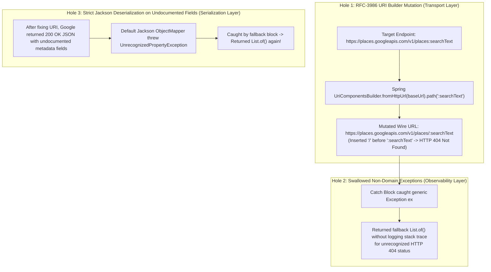

# Case Study 03: Post-Mortem — Diagnosing a 3-Layer Silent Failure in Google Places API v1 Migration

> **Engineering Pillars:** Production Incident Forensics · RFC-3986 URI Semantics · Anti-Corruption Layer (DDD) · Defensive Deserialization

---

## 1. Context & The Business-Critical Bug

The core value proposition of **SME Hitlist** is discovering local businesses (plumbers, clinics, contractors) that **do not have a website** (`website == null`), qualifying them as high-probability outreach targets for digital agency services.

Initially, the backend consumed the legacy Google Places Text Search endpoint (`GET /maps/api/place/textsearch/json`). During production auditing, we discovered a critical domain anomaly:
* The legacy endpoint's ranking algorithm heavily biased results toward businesses **with existing websites**, starving the pipeline of 0-website leads.
* Manual verification proved that the **New Google Places API v1 (`POST /v1/places:searchText`)** returned unbiased local business listings—including newly registered SMEs with zero web presence.

We migrated `GooglePlacesHttpClient` to the new `POST /v1/places:searchText` protocol with explicit `X-Goog-FieldMask` headers. Immediately after deployment, **the lead generation pipeline began failing silently**:
* Every scheduled and manual run logged: `Searching Google Places for category 'Plumber' in city 'Istanbul'...`
* Less than 200ms later, the job finished with: **`0 leads generated, 0 errors`** (`status = "success"`).

---

## 2. Three-Layer Forensic Root-Cause Diagnosis

Why did an external HTTP failure produce `0 leads` and `0 errors`? Following the **Swiss Cheese Model of System Accidents**, three distinct vulnerabilities aligned across the transport, observability, and serialization layers:



### Root Cause 1: `UriComponentsBuilder` Custom Verb Path Mutation
Google's v1 API uses gRPC-transcoded custom REST verbs appended with a colon (`:searchText`, per Google AIP-136) rather than a hierarchical slash (`/searchText`).
When `UriComponentsBuilder` parsed `.path("/v1/places").path(":searchText")`, its path-segment normalizer saw that `:searchText` did not begin with `/` and automatically prepended one—emitting `POST /v1/places/:searchText`. Google's edge router immediately rejected the malformed path with **HTTP 404 Not Found**.

### Root Cause 2: Exception Swallowing in Pipeline Fallback Logic
To prevent a single city's network blip from aborting a multi-city batch run, the client wrapper caught `Exception ex` and returned an empty `List.of()` when an error wasn't an explicit `GooglePlacesBillingException` or `GooglePlacesQuotaExceededException`—without logging `LOG.error("...", ex)`. Thus, the HTTP 404 was silently converted into "0 candidates found."

### Root Cause 3: Strict Jackson DTO Deserialization (`UnrecognizedPropertyException`)
Once we fixed the URL and exposed the error logs, the API returned HTTP `200 OK` with a valid JSON payload—yet the pipeline *still* returned 0 leads on certain queries!
Inspecting the raw payload revealed that Google Places v1 dynamically includes undocumented/contextual metadata properties on certain business records. Because the new response DTOs (`GooglePlacesNewSearchResponse`, `GooglePlaceNewApiResult`) lacked `@JsonIgnoreProperties(ignoreUnknown = true)`, strict Jackson deserialization failed on the entire batch whenever a single place contained an extra property.

---

## 3. Architectural Solution

### A. Explicit Pre-Validated URI Construction & Mandatory `X-Goog-FieldMask`
We bypassed segment auto-slashing for AIP-136 colon verbs by concatenating the base URL and custom method path explicitly before URI encoding, and enforced strict `X-Goog-FieldMask` headers so we only pay for the exact Data SKUs required:

```java
// Explicit concatenation preserves AIP-136 ':searchText' without injecting a leading '/'
String endpointUrl = baseUrl.endsWith("/")
    ? baseUrl.substring(0, baseUrl.length() - 1) + "/v1/places:searchText"
    : baseUrl + "/v1/places:searchText";

HttpHeaders headers = new HttpHeaders();
headers.setContentType(MediaType.APPLICATION_JSON);
headers.set("X-Goog-Api-Key", properties.getApiKey());
headers.set("X-Goog-FieldMask",
    "places.id,places.displayName,places.formattedAddress,places.rating," +
    "places.userRatingCount,places.types,places.websiteUri,places.nationalPhoneNumber,places.googleMapsUri"
);
```

### B. Resilient DTO Contracts (`@JsonIgnoreProperties(ignoreUnknown = true)`)
All external integration DTOs (`GooglePlacesNewSearchResponse`, `GooglePlaceNewApiResult`, `DisplayNameDto`) were hardened with `@JsonIgnoreProperties(ignoreUnknown = true)` so upstream schema additions never break runtime parsing.

### C. Domain Anti-Corruption Mapper (Zero Blast Radius on Core Pipeline)
Rather than leaking Google's new v1 JSON structure (`displayName.text`, `websiteUri`, `userRatingCount`) into `LeadGenerationPipelineService`, `LeadAsyncSaver`, or the database entities, we mapped the v1 wire DTOs directly into the existing immutable domain records (`GooglePlaceSummary` and `GooglePlaceDetails`):

| Google Places API v1 Wire Field | Anti-Corruption DTO (`GooglePlaceNewApiResult`) | Internal Domain Contract (`GooglePlaceSummary`) |
| :--- | :--- | :--- |
| `id` | `id()` | `placeId()` |
| `displayName.text` | `displayName().text()` | `name()` |
| `websiteUri` | `websiteUri()` | `website()` |
| `nationalPhoneNumber` | `nationalPhoneNumber()` | `formattedPhoneNumber()` |
| `userRatingCount` | `userRatingCount()` | `userRatingsTotal()` |

**Result:** `LeadGenerationPipelineService` required **zero lines of structural modification** during the API upgrade.

---

## 4. Lessons Learned & Engineering Guardrails Established

1. **Never Swallow Exceptions in Integration Adapters:** Every `catch (Exception ex)` block at an external I/O boundary must log `LOG.error` with the HTTP status code, request URI, and exception stack trace, and record the error message in `CronJobLog.errors`.
2. **Default to Tolerant Readers on External APIs (Postel's Law):** All third-party REST response records must declare `@JsonIgnoreProperties(ignoreUnknown = true)`.
3. **Test Custom REST Verbs (`:action`) Explicitly:** Added unit tests in `GooglePlacesHttpClientTest` asserting that the exact wire URI matches `/v1/places:searchText` (without `/:searchText`) and that payloads containing unknown JSON keys deserialize cleanly.
