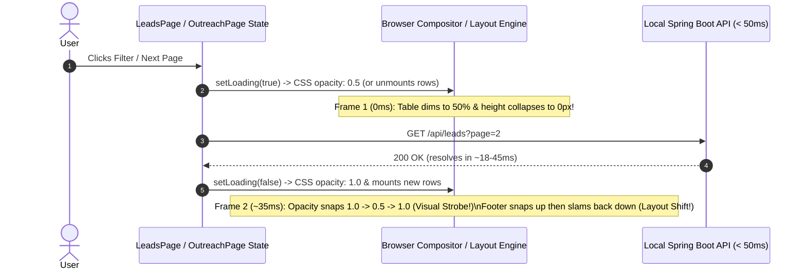

# Case Study 04: Frontend UX Engineering — Eliminating Sub-50ms Opacity Strobing & Layout Shift in React / TanStack Table v8

> **Engineering Pillars:** Frontend Rendering Performance · Perceived Latency & UX Ergonomics · Reusable Headless Component Architecture (React 18 + TanStack Table v8)

---

## 1. Context & User-Facing Problem

Operators working inside **SME Hitlist** spend hours triaging leads on `LeadsPage` and tracking prospect touchpoints on `OutreachPage`. Users reported a jarring, fatiguing visual defect:
* Every time a user typed into a search filter, toggled a status chip, or clicked "Next Page," the entire data table **violently flashed ("strobed")** and the pagination bar at the bottom of the screen **jumped upward and downward**.
* Surprisingly, this flickering persisted **even after migrating the state layer to TanStack Table v8 (`@tanstack/react-table`)**.

---

## 2. Why Naive Approaches Failed

### Why Migrating to a Headless Table Library Alone Didn't Fix It
A common misconception is that table flickering is caused by React virtual-DOM diffing overhead, and that swapping in a headless state manager (`useReactTable`) will automatically smooth out rendering.
In reality, TanStack Table v8 only manages row/column models in memory—it delegates 100% of DOM structure, loading transitions, and container geometry to the developer's JSX and CSS.

---

## 3. Three-Factor Root-Cause Diagnosis

Profiling the React component lifecycle and CSS paint frames across `LeadsPage` and `OutreachPage` revealed three compounding UX/DOM flaws (documented in **ADR-001**):



1. **Fast-Fetch Opacity Strobing (`1.0 -> 0.5 -> 1.0` in `< 50ms`):**
   When a filter changed, `loading` flipped to `true`, which immediately applied `opacity: 0.5` to the entire table container. Because the Spring Boot + PostgreSQL backend responded in `15–45ms`, `loading` immediately flipped back to `false` (`opacity: 1.0`). To the human eye, a sub-50ms luminance drop and recovery registers as a harsh **camera flash / strobe effect**.
2. **Container Height Collapse (Cumulative Layout Shift):**
   When filtering from 50 rows down to 2 rows (or clearing rows during a fetch), the table body had no minimum height reservation. The container collapsed instantly, yanking the `<Pagination />` controls and page footer hundreds of pixels upward before snapping them back down.
3. **Duplicated, Divergent Table Markup:**
   `LeadsPage` and `OutreachPage` each maintained custom CSS Grid markup, loading conditionals, and skeleton placeholders, making fixes inconsistent and blocking upcoming `FulfillmentPage` tables.

---

## 4. Architectural Solution: The Standardized `<DataTable />` Component

We engineered a single, reusable, headless-backed [`DataTable.jsx`](file:///C:/Dev/hitlist/frontend/src/components/DataTable.jsx) component that encapsulates `useReactTable` and enforces four strict visual invariants:

### Invariant 1: Zero Opacity Mutation During Background Re-Fetches
When `data.length > 0` and a filter or page change sets `loading = true`, the table rows **remain at `1.0` opacity**. We disable click interactions gracefully via `pointerEvents: loading ? 'none' : 'auto'` while keeping the existing data visually stable until the new payload arrives.

### Invariant 2: Non-Intrusive 2px Top Indeterminate Pulse Bar
Instead of dimming 80% of the viewport, background fetches are indicated by a 2px accent bar anchored at `top: 0` of the table card:
```jsx
{/* Subtle top loading bar instead of whole-table opacity strobing */}
<div style={{
  position: 'absolute', top: 0, left: 0, right: 0, height: 2,
  background: loading ? 'var(--accent)' : 'transparent',
  zIndex: 10,
  transition: 'background 0.2s',
  animation: loading ? 'pulseBar 1.5s infinite' : 'none'
}} />
```

### Invariant 3: Initial-Load-Only Skeletons (`loading && data.length === 0`)
`<SkeletonLoader rows={8} />` is rendered **exclusively** on cold initial mount when `data.length === 0`. Subsequent filter and pagination transitions never unmount the grid to show skeletons.

### Invariant 4: Enforced Geometric Stability (`minHeight: 400px` + Flex Column)
The outer table shell enforces `display: 'flex'`, `flexDirection: 'column'`, `flex: 1`, and `minHeight: 400`, while the scrollable row viewport claims `flex: 1`. Whether a query returns 50 leads, 2 leads, or 0 leads (empty state), the `<Pagination />` footer remains locked in place with **zero layout shift**.

---

## 5. Production Trade-Offs & Impact

| Metric / Engineering Dimension | Before (`LeadsPage` / `OutreachPage` Ad-Hoc Tables) | After (`<DataTable />` Standard) |
| :--- | :--- | :--- |
| **Visual Flicker on Fast Fetches (<50ms)** | Severe (`1.0 -> 0.5 -> 1.0` full-table opacity strobe) | **Eliminated** (`1.0` steady opacity + 2px top pulse bar) |
| **Cumulative Layout Shift (CLS) on Filter** | High (Footer jumps up/down by 300–600px) | **0.00 CLS** (`minHeight: 400px` + `flex: 1` body reservation) |
| **New Module Table Velocity (`FulfillmentPage`)** | ~250 lines of duplicated CSS Grid + pagination wiring per page | **~25 lines** of declarative `columns` definition passed to `<DataTable />` |
