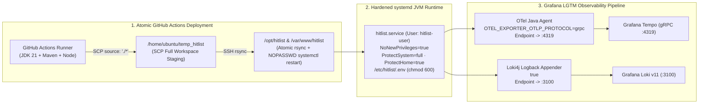

# Case Study 05: Bare-Metal Linux Operations, Grafana LGTM Observability & CI/CD Hardening

> **Engineering Pillars:** Distributed Tracing & Log Aggregation (OpenTelemetry + LGTM) · Linux `systemd` Security Sandboxing · CI/CD Deployment Atomicity · Production Resilience

---

## 1. Context & Production Challenges

Unlike managed PaaS deployments that abstract away networking, process isolation, and telemetry pipelines, **SME Hitlist** is deployed on bare-metal Ubuntu Linux infrastructure with a self-hosted **Grafana LGTM observability stack (Loki, Grafana, Tempo, Prometheus)** and automated **GitHub Actions CI/CD**.

During production bring-up and operational hardening, four critical infrastructure and reliability failures surfaced across the stack:
1. **Distributed Tracing Blackout (`Connection reset by peer`):** The OpenTelemetry Java Agent failed to export traces from Spring Boot to Grafana Tempo.
2. **Centralized Logging Rejections (`HTTP 400 Bad Request`):** `Loki4j` log shipping from `logback-spring.xml` was rejected by Grafana Loki.
3. **Silent CI/CD Artifact Drops:** GitHub Actions `appleboy/scp-action` wildcard transfers (`frontend/dist/*`) intermittently failed or transferred partial bundles, while `systemctl restart` hung in non-interactive SSH sessions.
4. **Startup Crash Loops on Config Drift:** Strict `@PostConstruct` validation threw fatal exceptions when unexpected environment variables were injected in production.

---

## 2. Root-Cause Forensics & Engineering Solutions



### A. Resolving OpenTelemetry vs. Grafana Tempo Port & Protocol Collisions
* **Root Cause:** To prevent internal gRPC port `9095` from colliding between Grafana Loki and Grafana Tempo on the same host, Tempo's OTLP gRPC receiver was custom-mapped to port **`4319`**. However, the standard OpenTelemetry Java Agent defaults its exporter protocol to **`http/protobuf`** (expecting an HTTP/1.1 endpoint on port `4318`). Sending `http/protobuf` frames to Tempo's raw gRPC socket on `4319` caused immediate TCP `Connection reset by peer` errors.
* **Architectural Fix:** Explicitly pinned the wire protocol in `/etc/hitlist/.env` and `application-prod.yml`:
  ```bash
  OTEL_EXPORTER_OTLP_ENDPOINT=http://127.0.0.1:4319
  OTEL_EXPORTER_OTLP_PROTOCOL=grpc
  ```

### B. Fixing Grafana Loki v11 Schema `HTTP 400` Rejections
* **Root Cause:** Modern `loki4j-logback-appender` releases automatically attach OpenTelemetry/MDC attributes as Loki **Structured Metadata**. However, our Loki instance used the **v11 storage schema**, which strictly forbids structured metadata unless TSDB v13+ is enabled—resulting in every log batch failing with `HTTP 400 Bad Request`. Furthermore, placing `<noStructuredMetadata>true</noStructuredMetadata>` inside the `<format>` block of `logback-spring.xml` is silently ignored by XML binding.
* **Architectural Fix:** Configured `<noStructuredMetadata>true</noStructuredMetadata>` as a direct child of `<appender name="LOKI" class="com.github.loki4j.logback.Loki4jAppender">` in `logback-spring.xml`, restoring 100% log ingestion with trace-ID correlation in labels.

### C. Atomic CI/CD Staging & Non-Interactive `systemd` Orchestration
* **Root Cause:** `appleboy/scp-action` mishandles glob wildcards (`source: "frontend/dist/*"`), and `appleboy/ssh-action` executes in a non-TTY shell that cannot respond to `sudo` password prompts.
* **Architectural Fix:**
  1. **Two-Phase Staging + `rsync`:** Transfer the workspace deterministically to `/home/ubuntu/temp_hitlist` and execute an atomic `rsync -a --delete` over SSH into the production directories.
  2. **Scoped Non-Interactive Service Restart:** Configured `/etc/sudoers.d/99-github-actions` so the CI deploy user can execute `systemctl restart hitlist.service` without interactive TTY blocking.

### D. Linux `systemd` Privilege Sandboxing & Startup Resiliency
* **Principle of Least Privilege (`hitlist.service`):**
  * Dedicated unprivileged system account: `useradd -r -s /bin/false hitlist-user`.
  * Isolated secrets file `/etc/hitlist/.env` owned by `hitlist-user:hitlist-user` with `chmod 600`.
  * Enforced kernel/filesystem sandboxing directives in `/etc/systemd/system/hitlist.service`:
    ```ini
    [Service]
    User=hitlist-user
    EnvironmentFile=/etc/hitlist/.env
    ExecStart=/usr/bin/java -jar /opt/hitlist/hitlist.jar
    SuccessExitStatus=143
    Restart=always
    RestartSec=10
    NoNewPrivileges=true
    ProtectSystem=full
    ProtectHome=true
    ```
* **Graceful Startup Degradation:** Replaced brittle `@PostConstruct` `IllegalStateException` crashes on non-critical environment mismatches with structured `LOG.warn` alerts and safe fallback defaults so config drift never triggers a `systemd` crash loop.

---

## 3. Defense-in-Depth Production Checklist Established

Beyond immediate incident resolution, we codified a comprehensive **Production Security & Reliability Baseline** (synced in [`docs/OPERATIONS_AND_TROUBLESHOOTING.md`](../OPERATIONS_AND_TROUBLESHOOTING.md)):
* **Nginx Edge Hardening:** Rate limiting (`limit_req_zone`) on `/api/` and `/api/auth/`, buffer overflow caps (`client_body_buffer_size`), `server_tokens off;`, HSTS (`max-age=31536000; includeSubDomains`), and TLS 1.2/1.3 cipher enforcement.
* **Redis Hardening:** Strict loopback binding (`bind 127.0.0.1`), `requirepass` authentication, and disabling destructive commands (`FLUSHALL`, `FLUSHDB`, `CONFIG`).
* **PostgreSQL + PostGIS Recovery:** Daily offsite `pg_dump` automation paired with pre-restore `CREATE EXTENSION IF NOT EXISTS postgis;` validation and WAL Point-in-Time Recovery (PITR) guidelines.
